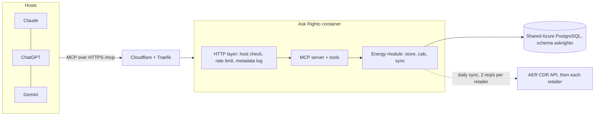

# Architecture

How Ask Righto is put together, why, and how it grows. Written 15 November 2026, after the
first real energy load on the Australia East VM. Detail lives in the other docs; this page
explains how the parts fit and which decisions shaped them.

- Requirements and rules: [`AGENTS.md`](../AGENTS.md), [`ROADMAP.md`](../ROADMAP.md)
- Energy data: [`energy-data.md`](energy-data.md), estimates: [`energy-estimates.md`](energy-estimates.md)
- Adding a tool: [`adding-a-tool.md`](adding-a-tool.md), deploy: [`deploying.md`](deploying.md)

## 1. What it has to do

Ask Righto answers everyday Australian questions (energy plans first, then uni courses and
health cover) from public data. It ships as **one hosted remote MCP server** that the Claude
directory, the ChatGPT plugin directory and Gemini all connect to. The host's model does the
talking; our server supplies the facts.

The five rules in `AGENTS.md` drive almost every design choice:

| Rule | What it forces in the design |
| --- | --- |
| Every fact traces to a lookup | A result envelope that cannot carry a figure without a source and date |
| Open data only | Sources limited to CDR product data, CC BY datasets or written permission; no scraping |
| Stateless for users | No accounts or conversation storage; the database holds public reference data only |
| No ads | No placement logic anywhere; tools are read-only |
| Factual comparison, not advice | Neutral wording ("lowest estimate for the usage you gave"), a notice on every result, no "best" |

## 2. The system at a glance

Request path (`tools/call`): host model calls a tool, the server reads stored data from
PostgreSQL, and returns a grounded result. **No request ever reaches the CDR API.** Only the
sync job talks to retailers, so user traffic cannot trigger load on them and tool answers do
not depend on a retailer being up.

## 3. Layers in the code

| Layer | Where | Job |
| --- | --- | --- |
| Entry and HTTP | `src/main.ts`, `src/config.ts`, `src/server/limits.ts` | Streamable HTTP on `/mcp`, `/healthz` (liveness), `/readyz` (data loaded), per-client rate limit, host allow-list, metadata-only access log |
| Server core | `src/server/create-server.ts`, `instructions.ts` | One stateless server per request; instructions the host model receives on `initialize` |
| Grounded envelope | `src/core/grounded.ts` | `Found<T>` (data, source, as-of, warnings) or `NotFound` (reason, message). There is no third shape |
| Tool definition | `src/core/define-tool.ts` | `defineTool` refuses to start the server on a tool the directories would reject (naming, annotations, nested schemas) |
| Registries | `src/core/registry.ts`, `readiness.ts` | Datasets declare source, coverage, refresh time and max age (feeds `list_data_sources` and stale warnings); readiness checks gate `/readyz` |
| Energy module | `src/energy/*` | CDR client and limiter, normaliser, store, calculator, sync and scheduler, migrations |
| Tools | `src/tools/*` | `search_energy_plans`, `get_energy_plan`, `compare_energy_plans`, `list_data_sources`, plus Inkview wrapping |

Everything below the tools is plain TypeScript functions, so unit tests cover the calculator and
normaliser without a server, and end-to-end tests spawn the real bundle over HTTP.

## 4. How it meets the current requirements

### 4.1 Grounded facts

A tool handler can only return `found({ data, source, asOf })` or `notFound(reason, message)`.
`found` throws if the source name, URL, licence or date is missing. The text the host sees is
rendered by us and always ends with the notice and source line. The server instructions tell the
host to quote tool results only and to relay `found: false` plainly. The model narrates; it never
supplies a number.

Where a figure cannot be trusted yet, the tool says so instead of guessing: plans that are not
fully understood are listed with a reason, and **while the GST basis is unconfirmed no dollar
amount is shown at all** (section 7).

### 4.2 Energy plan data (own copy, not a live proxy)

Choice: keep our own daily copy of the CDR plan data in PostgreSQL instead of calling retailers
per question.

- Retailers set their own rate limits and have no SLA; a live proxy would put a user's wait and our
  correctness in their hands.
- Search by postcode, fuel and distributor needs an index (`coverage_sets` with a GIN postcode
  index), which the source APIs do not offer.
- We can re-derive everything: `plans` keeps the raw payload and its hash, so a parser fix is a
  re-normalise, not a re-download. The copy is rebuildable from the source (rule 3).

Costs of the choice: data is up to a day old (every result carries its as-of date and the
registry warns when it exceeds `maxAgeHours`), and the copy stays internal behind the tools with
no bulk export.

### 4.3 The sync

Per retailer, in one transaction, so a failed retailer keeps its stored plans and the others
carry on:

1. List `CURRENT` and `FUTURE` plans (cheap).
2. Fetch detail only for new plans or ones whose `lastUpdated` changed.
3. Re-fetch the longest-unverified unchanged plans, about a seventh a day, and compare content
   hashes. A difference with an unchanged `lastUpdated` is a "silent change", recorded and
   reported. This guards against retailers that change a plan without bumping the date.
4. Remove plans no longer listed.

Politeness and safety: at most 2 requests a second and one in flight per retailer, 8 overall, and
a 429 halves that retailer's rate and honours `Retry-After`. A PostgreSQL advisory lock keyed by
schema lets one instance sync at a time. The server never starts the first load itself, so
`/readyz` stays 503 `no_data_loaded` until an operator has run it and looked at the report.

First real load (AGL, 15 Nov 2026): 727 plans, 739 requests, 0 throttled, 393 seconds. A first
load is slow by design because every plan's detail is fetched; later runs fetch only changed plans
plus about a seventh as a re-check.

### 4.4 Money and estimates

Rates are stored as integer hundred-thousandths of a dollar, never floats. `calc.ts` is a pure
function: yearly cost from published rates and the usage the user gave, each component rounded
once to the cent so the breakdown sums exactly to the total. Anything it cannot work out
(`demand_tariff`, `needs_time_of_use_split`, `not_fully_understood`, `gst_basis_unknown` and so on)
comes back as `NotEstimated` with a reason. Conditional discounts are shown but excluded from the
ordering, so a plan is not ranked on a condition the user may not meet. Wording stays neutral.

### 4.5 Deploy and operation (Azure Australia East)

- **Image**: two-stage Docker build to one bundled file, run as the non-root `node` user, pushed
  to `ghcr.io/feimacode/askrighto` by GitHub Actions (`:latest` and `:sha-…` from main, `:x.y.z`
  from `v*` tags) with a `/healthz` smoke test.
- **Hosting**: Compose on its own network behind Traefik and Cloudflare, on the shared
  Australia East VM, deployed by the `askrighto` Ansible role in `feimacode/feima-infra`. This is
  the same pattern Inkview uses, so there is one way to deploy things.
- **Database**: shared Flexible Server `feimacode.postgres.database.azure.com`, private to the VM's
  VNet, own database and role, schema `askrighto`. The app only touches schemas named `askrighto`
  or `askrighto_*`. Migrations are embedded in the bundle and run by the playbook before the
  container starts; TLS is verified (working on the new server).
- **Secrets** live in ansible-vault; none are in the repo or image.
- **Domain**: `askrighto.feimacode.com` for internal testing, then `askrighto.com.au`.
- **Stdio** mode exists for development (MCP Inspector, local debugging) and is documented as
  such; it would need database credentials, so it is not a product surface.

### 4.6 Privacy and abuse

No accounts, sessions or stored conversations. The access log holds method, path, status, timing,
JSON-RPC method and tool name, never arguments or results. Requests are rate limited per client
(from the Cloudflare IP header), bodies are size limited, and the host allow-list blocks DNS
rebinding on `/mcp`. Every tool is read-only and annotated so the strictest host rules (OpenAI
hints, Google flat schemas) are met.

## 5. Key decisions and trade-offs

| Decision | Chosen because | Gives up |
| --- | --- | --- |
| One stateless hosted server for all three directories | One tool schema, one set of reviews | Per-host tuning; features that need a user session |
| Own database copy of CDR data | Fast, indexed, independent of retailer uptime, rebuildable | Freshness (up to a day), a second copy to keep correct |
| Delta sync plus rolling re-check | A few hundred requests a day, catches silent changes | More logic than a nightly full reload |
| Per-retailer rate limits, not one global one | Retailers limit individually; one slow retailer must not slow the rest | Needs per-retailer observed limits over time |
| Integer money, pure calculator | Exact, testable, repeatable | Verbose; no "close enough" shortcuts |
| Refuse to show dollars while GST is unknown | A wrong price is worse than no price | The live server shows no costs yet |
| Envelope that cannot omit source or date | Trust is the main user objection | Slightly heavier tool code |
| Shared Postgres with its own schema | One operated database already exists; schema-scoped lock and migrations | Shared-instance coupling; admin needed for first setup |
| Embedded migrations | The bundle is self-contained; the container needs no files | Migrations are TypeScript modules, not loose SQL |
| Inkview components beside the grounded envelope | Hosts that draw components get a table; every host still gets text, source and date | Two output forms to keep in step |

## 6. How it supports the future

### 6.1 More retailers and states

Adding a retailer is a line in `src/energy/retailers.json`; only AGL, Origin and EnergyAustralia
are seeded. The sync, limiter and report already work per retailer, and one failing retailer
never blocks the others. The full list comes from the AER base URI document and the CDR Register.
Real data will bring new plan shapes; unknown shapes are kept and flagged, not guessed
(section 7). Gas and dual fuel are stored; coverage today is NSW, QLD, SA, TAS, VIC and the ACT.

### 6.2 New verticals (uni courses, health cover, solar and battery)

A vertical is a module plus tools, with no change to the core:

1. A data module that registers a `DataSet` (source, licence, coverage, max age), optionally adds a
   readiness check, and owns its tables in the `askrighto` schema through a new migration.
2. Tools written with `defineTool` and added to `src/tools/index.ts`.
3. A paragraph of host guidance added through `addInstructions`.

The grounded envelope, registry, rate limits and deploy pipeline are shared. What
differs is the data source: energy is a sync from an API, uni courses are own-worded facts with
links (no admissions centre offers an open licence), health cover is a monthly CC BY file, and
keyed APIs such as VIC fuel prices carry a mandatory attribution. The envelope's `licence` and `attribution`
fields exist so each source's reuse terms travel with its facts. The roadmap order (energy, VIC
courses, health cover, NSW and QLD courses, solar and battery) follows the case scoring in
`ROADMAP.md`: complexity, aggregated data and audience, gated by data rights.

### 6.3 More directories (ChatGPT, Gemini)

The server speaks plain MCP over Streamable HTTP, so all three directories point at the same
URL. Tool names, annotations and flat schemas already follow the strictest rules (OpenAI hints,
Google flat schemas, no nested inputs). Remaining work is packaging rather than server code: the Claude plugin bundle, the ChatGPT plugin
ZIP and the Gemini registration.

### 6.4 The Inkview UI layer

Results can already be drawn as components with `@feimacode/inkview-sdk` (`inkview.table`,
`entityCard`). `inkviewResult` puts the component in `structuredContent` and carries our grounded
envelope beside it under `grounded`, so a host that draws components shows the view while any host
still gets source, date and notice in the text. A component that fails validation is skipped and
the plain result is returned, so UI trouble never loses an answer. Future verticals reuse this and
add comparisons (cover, courses) or maps and listings (suburbs).

### 6.5 Scale and operations

The server is stateless, so more instances only need a load balancer; the advisory lock keeps
the sync to one. Postgres use is small (727 AGL plans are about 5 MB), the pool is capped at 5 per
instance, and reads are indexed. Rollback is re-running the playbook with an earlier
`askrighto_version`. If the shared database becomes a constraint, the data layer is behind
`store.ts`, which is the one place to change.

## 7. Open items and known risks

| Item | State | Why it matters |
| --- | --- | --- |
| GST basis of CDR amounts | `EXCLUSIVE` since 16 Nov 2026, checked on a real AGL plan against its fact sheet; fees are GST inclusive ([cdr-schemas.md](cdr-schemas.md)) | Stored plans need `renormalise-energy` after deploy before prices show |
| AGL solar feed-in shapes | 21 of 727 plans `solarFeedIn:unknown_shape` ([#8](https://github.com/feimacode/askrighto/issues/8)). The normaliser read v3 `timeVaryingTariffs` as an object; it is an array. Fixed; run `renormalise-energy` on the server to confirm | Those plans lack feed-in figures until re-normalised |
| Real fixtures | One recorded AGL plan; the rest are synthetic. Record more (`sync:energy -- --record`) | Locks the normaliser to real data |
| AGL time-of-use band names | AGL labels both bands `SHOULDER`, so its time-of-use plans are not estimated | Needs the user's split matched to bands by time window (design change) |
| Retailer list | 3 of many seeded; only AGL loaded | Coverage is incomplete until the list is seeded and loaded |
| Estimate check | Not yet compared with retailer fact sheets | Accuracy claim for estimates |
| Live host tests | Not run through a tunnel; MCP Inspector check pending | Real-world tool behaviour |

None of these change the shape of the system. The GST gate and the unknown-shape handling are
designed so the server says what it does not know and fails safe until the data is confirmed.
