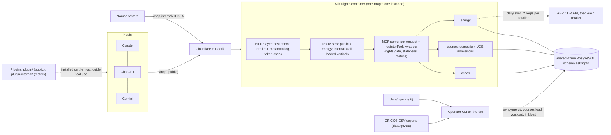

# Architecture

How Ask Righto is put together, why, and how it grows. First written 15 November 2026 after the
first real energy load; refreshed 16 November 2026 for the verticals, canary release, skills and
plugins, CDR schema fixes, Victorian courses and the international course finder (PRs #11 to #17). Vertical ids are `energy`, `courses-domestic` and `cricos` (earlier `courses` and `international`, still accepted with a warning).
This page explains how the parts fit and which decisions shaped them. **Implementation detail for
each area is in [`docs/areas/`](areas/)**, linked from section 3.

- Requirements and rules: [`AGENTS.md`](../AGENTS.md), [`ROADMAP.md`](../ROADMAP.md)
- Other reference docs: [`deploying.md`](deploying.md), [`adding-a-tool.md`](adding-a-tool.md),
  [`data-rights.md`](data-rights.md), [`promotion-checklist.md`](promotion-checklist.md)

**How these docs were checked.** The area docs were written by reading the code at commit
`ff220c9` (main after PR #17), with file paths cited. Nothing was run to produce them. Statements
marked **(inferred)** are a reading of the code, and **(unverified)** marks things the repo cannot
show (live infrastructure, real host behaviour, data not yet loaded). If a doc and the code
disagree, the code wins; please fix the doc.

## 1. What it has to do

Ask Righto answers everyday Australian questions from public data. It ships as **one hosted remote
MCP server** that the Claude directory, the ChatGPT plugin directory and Gemini all connect to. The
host's model does the talking; our server supplies the facts. Today there are three **verticals**:
energy plans (public), Victorian uni courses with VCE planning, and courses for international
students (both internal-only until promotion).

The five rules in `AGENTS.md` drive almost every design choice:

| Rule | What it forces in the design |
| --- | --- |
| Every fact traces to a lookup (or an official page read by the user's own assistant) | A result envelope that cannot carry a figure without a source and date; "index only" courses return links and a reading checklist instead of facts; server never stores or accepts facts read by a host |
| Open data only | Sources limited to CDR product data, CC BY datasets or written permission; a rights register that blocks pending datasets in production; course facts re-keyed in our own words |
| Stateless for users | No accounts or conversation storage; the database holds public reference data only, rebuildable from source |
| No ads | No placement logic anywhere; tools are read-only |
| Factual comparison, not advice | Neutral wording ("lowest estimate for the usage you gave"), a notice on every result, banned phrases ("best", "chance", "you will get in"), no visa advice |

## 2. The system at a glance

Request path (`tools/call`): the host model calls a tool, the server reads stored data from
PostgreSQL, and returns a grounded result. **No request ever reaches the CDR API or a university
page.** Only the energy sync job talks to retailers, and the course and international data are
loaded by an operator from files, so user traffic cannot trigger load on any source and tool answers
do not depend on one being up.

## 3. Areas and where to read the detail

Every area doc covers (1) how data is loaded and refreshed, (2) how the tables and objects are
linked, with diagrams, and (3) the main functions and how they serve the end-to-end processes.

| Area | Doc | Public? | One-line summary |
| --- | --- | --- | --- |
| Platform | [`areas/platform.md`](areas/platform.md) | n/a | HTTP and MCP server, `defineTool`, grounded envelope, registry, readiness, metrics, rights gate, verticals and release channels, DB and migrations, build and deploy |
| Energy plans | [`areas/energy-plans.md`](areas/energy-plans.md) | yes | CDR sync into PostgreSQL, normaliser, store, cost calculator, three tools |
| VIC uni courses and VCE planning | [`areas/vic-courses.md`](areas/vic-courses.md) | internal | YAML course index plus CRICOS, curated facts, prerequisite rules, VCE dates, scaling, aggregate; eight tools |
| International courses | [`areas/international-courses.md`](areas/international-courses.md) | internal | CRICOS higher-education courses with fees, durations and campuses; four tools |
| Skills and plugins | [`areas/skills-and-plugins.md`](areas/skills-and-plugins.md) | public plugin: yes; internal plugin: no | grounding, energy bill, VCE course and international skills; shared rules generated from one source |
| Private health cover | [`areas/health-cover.md`](areas/health-cover.md) | internal | PHIO monthly file into PostgreSQL, dated rebate, surcharge and loading rules in YAML, integer-cents calculator, seven tools; file layout assumed until a real ZIP is opened |
| Review and comparison | [`areas/review-and-comparison.md`](areas/review-and-comparison.md) | maintainers | coverage report, answer-review skill, number trace |

Older topic docs stay as deeper references: [`energy-data.md`](energy-data.md),
[`energy-estimates.md`](energy-estimates.md), [`cdr-schemas.md`](cdr-schemas.md),
[`course-data.md`](course-data.md), [`course-tools.md`](course-tools.md),
[`vce-admissions-data.md`](vce-admissions-data.md), [`intl-course-data.md`](intl-course-data.md),
[`cricos-columns.md`](cricos-columns.md), [`use-case-comparison/`](use-case-comparison/protocol.md).

## 4. Layers in the code

| Layer | Where | Job |
| --- | --- | --- |
| Entry and HTTP | `src/main.ts`, `src/config.ts`, `src/server/limits.ts`, `src/server/internal.ts` | Streamable HTTP on `/mcp` and `/mcp-internal/<token>`, `/healthz`, `/readyz`, internal readiness and metrics, per-client rate limit, host allow-list, metadata-only access log; CLI commands (`migrate`, `sync-energy`, `courses:*`, `vce:*`, `intl:*`, `compare:usecases`, `renormalise-energy`) |
| Verticals | `src/verticals.ts`, `src/server/route.ts`, `src/<vertical>/vertical.ts` | Which tools, guidance and start-up each vertical brings; per-route sets built from two environment variables |
| Server core | `src/server/create-server.ts`, `instructions.ts` | One stateless MCP server per request; instructions the host receives on `initialize` |
| Grounded envelope | `src/core/grounded.ts` | `Found<T>` (data, source, as-of, warnings) or `NotFound` (reason, message). There is no third shape |
| Tool definition | `src/core/define-tool.ts` | `defineTool` and `registerTools` refuse a tool the directories would reject and wrap every handler with the rights gate, staleness and attribution, metrics and rendering |
| Registries and rights | `src/core/registry.ts`, `readiness.ts`, `rights.ts`, `rights.json`, `metrics.ts` | Datasets declare source, coverage, refresh time and max age; the rights register decides what may be served in production |
| Database | `src/energy/db.ts`, `src/energy/migrations/0001..0004` | Pool, schema guard, embedded migrations (shared by all verticals despite the folder name) |
| Verticals' modules | `src/energy/*`, `src/courses/*`, `src/vce/*`, `src/intl/*` | Loaders, stores, parsers, calculators |
| Tools | `src/tools/*` | 3 energy, 8 course and planning, 4 international, plus `list_data_sources` per route; Inkview wrapping |
| Guidance | `src/guidance/shared.ts`, `plugin/`, `plugin-internal/`, `.claude/skills/` | Shared rules, skills, maintainer review skill |
| Maintainer tooling | `src/compare/*`, `scripts/*` | Coverage report, build, guidance generator, release check, number trace |

Everything below the tools is plain TypeScript functions, so unit tests cover the calculator,
normalisers and prerequisite evaluator without a server, and end-to-end tests spawn the real bundle
over HTTP.

## 5. How it meets the current requirements

### 5.1 Grounded facts

A tool handler can only return `found({ data, source, asOf })` or `notFound(reason, message)`.
`found` throws if the source name, URL, licence or date is missing. The text the host sees is
rendered by us and always ends with the notice and source line. Server instructions and skills tell
the host to quote tool results only and to relay `found: false` plainly. The model narrates; it
never supplies a number.

Where a figure cannot be trusted yet, the tool says so instead of guessing: energy plans that are
not fully understood are listed with a reason and not costed; course rows with no checked facts say
"index only" and give links; scaling that lacks permission answers `data_unavailable` in production.

Where our tools hold no checked facts, the host's own browsing assistant may read the official page
on the user's behalf. Those facts must be quoted with link and time and labelled as read by the
assistant, are never sent back to or stored by our server, and never get past a bot check
(AGENTS.md rule 1). The tool results carry a reading checklist and these rules.

### 5.2 Own data copy, loaded by operators

Choice: keep our own copy of each dataset in PostgreSQL instead of calling sources per question.

- Retailers set their own limits and have no SLA; universities block bots. A live proxy would put the
  user's wait and our correctness in someone else's hands.
- Search by postcode, field or study needs an index that the sources do not offer.
- Each copy can be rebuilt: energy keeps the raw payload and a hash so a parser fix is a
  re-normalise; course data comes from git-tracked YAML and CRICOS exports (rule 3).

Costs: data is as old as the last load (energy up to a day; courses and international as old as the
last manual load; every result carries its as-of date and the registry warns beyond `maxAgeHours`),
and the copy stays internal behind the tools with no bulk export.

### 5.3 Energy sync, money and estimates (summary)

Per retailer, one transaction; list then fetch only new, changed and one-seventh re-check plans;
silent changes recorded; 2 requests a second per retailer; advisory lock; the server never starts
the first load. Rates are integers in hundred-thousandths of a dollar; the calculator is a pure
function that returns `NotEstimated` with a reason for anything it cannot work out; conditional
discounts are shown but excluded from the ordering. The GST basis is `EXCLUSIVE`, confirmed on a
real AGL plan on 16 Nov 2026 (PR #13), and fees are costed as published (GST inclusive). Full detail:
[`areas/energy-plans.md`](areas/energy-plans.md).

### 5.4 Course data (summary)

One `courses` table with `origin` (`cricos` or `gap_fill`) and `depth` (`index_only` or `curated`).
Curated rows carry figures labelled by kind and intake year, structured prerequisite rules, and
own-words summaries (60 words at most, no banned phrases). Prerequisite checks are a pure recursive
evaluator; the VCE aggregate is a pure function over scaling tables that are `pending` permission.
International courses are a separate set of tables from the CRICOS register. Detail:
[`areas/vic-courses.md`](areas/vic-courses.md), [`areas/international-courses.md`](areas/international-courses.md).

### 5.5 Release channels (canary)

One image, one instance. `ASKRIGHTO_VERTICALS` says what the process loads and
`ASKRIGHTO_PUBLIC_VERTICALS` what `/mcp` serves; `/mcp-internal/<token>` serves everything loaded
and answers 404 without the right token. Each request builds its server from its route's verticals,
so a public client cannot list, call or read the instructions of an internal-only tool, nor see its
datasets in `list_data_sources`. `/readyz` reflects public verticals only. Counters of outcomes
(`curated`, `index_only`, `cannot_check`, `not_in_dataset`, `data_unavailable`, `needs_input`,
errors, latency) are kept per tool and route in memory and never hold arguments or results. The
rights gate applies on both routes in production. Promotion is a settings change guarded by
[`promotion-checklist.md`](promotion-checklist.md). Detail: [`areas/platform.md`](areas/platform.md).

### 5.6 Skills and plugins

Server instructions go to every host on `initialize`; skills add multi-turn intake and wording. The
public plugin (`plugin/`) holds `ask-righto-grounding` and `energy-bill-comparison`. The internal
plugin (`plugin-internal/`) holds `vce-course-research` and `intl-course-finder` for testers. The
base rules come from one file, `src/guidance/shared.ts`, which feeds both the server instructions and
a generated `rules.md`; CI fails if the generated copy is stale. A maintainer-only skill
(`.claude/skills/ask-righto-answer-review`) repeats the hand protocol for checking answers, with
`scripts/trace-numbers.mjs` flagging figures that are in neither the prompt nor a tool result.
Skills contain no agents or hooks and no provider names so they convert across hosts. Detail:
[`areas/skills-and-plugins.md`](areas/skills-and-plugins.md),
[`areas/review-and-comparison.md`](areas/review-and-comparison.md).

### 5.7 Deploy and operation (Azure Australia East)

- **Image**: two-stage Docker build to one bundled file, run as the non-root `node` user, pushed to
  `ghcr.io/feimacode/askrighto` by GitHub Actions (`:latest` and `:sha-...` from main, `:x.y.z` from
  `v*` tags) with a `/healthz` smoke test. The image includes `data/` (course YAML, VCE files) but not
  `data/local/`.
- **Hosting**: Compose on its own network behind Traefik and Cloudflare, on the shared Australia East
  VM, deployed by the `askrighto` Ansible role in `feimacode/feima-infra` (same pattern as Inkview).
- **Database**: shared Flexible Server, private to the VM's VNet, own database and role, schema
  `askrighto`. The app touches only schemas named `askrighto` or `askrighto_*`. Migrations are
  embedded and run by the playbook before the container starts; TLS is verified.
- **Secrets** live in ansible-vault, including the internal route token; none are in the repo or image.
- **Domain**: `askrighto.feimacode.com` for internal testing, then `askrighto.com.au`.
- **Operator commands** run inside the container: `migrate`, `sync-energy`, `renormalise-energy`,
  `courses:load`, `vce:load`, `intl:load`.
- **Stdio** mode exists for development and loads energy only; it is not a product surface.

### 5.8 Privacy and abuse

No accounts, sessions or stored conversations. The access log holds method, path (internal token
masked), status, timing, JSON-RPC method and tool name, never arguments or results. Counters hold
outcomes only. Requests are rate limited per client, bodies are size limited, and the host allow-list
blocks DNS rebinding. Every tool is read-only and annotated so the strictest host rules (OpenAI
hints, Google flat schemas) are met. No tool asks for a name, school, age or contact details.

## 6. Key decisions and trade-offs

| Decision | Chosen because | Gives up |
| --- | --- | --- |
| One stateless hosted server for all three directories | One tool schema, one set of reviews | Per-host tuning; features that need a user session |
| Verticals behind two route sets in one instance (not a second container) | Cheap canary; promote or roll back by changing settings | One process failure affects both routes; a failed internal vertical is stubbed so the public route survives |
| Rights register enforced in code, not only in a document | A pending dataset cannot be served in production by mistake | Every dataset needs an entry before it can register in production |
| Own database copy of source data | Fast, indexed, independent of source uptime, rebuildable | Freshness; a second copy to keep correct |
| Delta sync plus rolling re-check (energy) | A few hundred requests a day; catches silent changes | More logic than a nightly full reload |
| Per-retailer rate limits | Retailers limit individually | Needs observed limits over time |
| Integer money, pure calculator | Exact, testable, repeatable | Verbose; no "close enough" shortcuts |
| Plans not understood are kept and flagged, never coerced | A wrong price is worse than no price | Some plans show no estimate until the normaliser learns the shape |
| Course index first, curated facts second (`depth`) | Broad coverage without copying facts we have no right to | Most courses return links and a checklist, not figures |
| Own-words facts with a link, 60-word summaries | Avoids reproducing university pages | Curation effort; legal view still pending |
| Guided browsing by the user's assistant, never by our server | Lowers copyright and scraping risk (rule 1) | Depends on host browsing, untested on real sites |
| Separate international tables and vertical | International facts cannot leak into domestic answers | Duplicate concepts; join only on CRICOS code |
| Skills-only plugins, shared rules generated from one file | Same text works across hosts; no drift in the base rules | Vertical guidance is still written in two places |
| Envelope that cannot omit source or date | Trust is the main user objection | Slightly heavier tool code |
| Shared Postgres with its own schema | One operated database exists; schema-scoped lock and migrations | Shared-instance coupling |
| Inkview components beside the grounded envelope | Hosts that draw components get a table; every host still gets text, source and date | Two output forms to keep in step |

## 7. How it supports the future

### 7.1 More retailers, states and verticals

Adding a retailer is a line in `src/energy/retailers.json`; sync, limiter and report already work per
retailer. Adding a vertical means: a data module that registers its `DataSet`, readiness check and
migration; tools written with `defineTool`; a `Vertical` object added to `ALL_VERTICALS` and the
known list in `src/verticals.ts`; a rights entry; guidance text; then an internal-route trial and the
promotion checklist. The roadmap order (energy, VIC courses, health cover, NSW and QLD courses, solar
and battery) follows the case scoring in `ROADMAP.md`. International courses are recorded as a later
candidate, domestic first. Bank product data (CDR banking schemas) follows the same pattern as energy;
see [`cdr-schemas.md`](cdr-schemas.md).

### 7.2 More directories

The server speaks plain MCP over Streamable HTTP, so all three directories point at the same URL;
tool names, annotations and flat schemas already follow the strictest rules. Remaining work is
packaging: the Claude plugin bundle exists (`plugin/`), while the ChatGPT plugin ZIP and Gemini
registration are not built, and the activation prompts have not been run on real hosts.

### 7.3 The Inkview UI layer

Results can be drawn as components with `@feimacode/inkview-sdk`. `inkviewResult` puts the component
in `structuredContent` and carries the grounded envelope beside it, so every host still gets source,
date and notice in the text. A component that fails validation is skipped and the plain result is
returned.

### 7.4 Scale and operations

The server is stateless, so more instances only need a load balancer; the advisory lock keeps energy
sync to one. Postgres use is small, the pool is capped at 5 per instance, and course and
international snapshots are cached in memory for five minutes. Rollback is re-running the playbook
with an earlier `askrighto_version` or removing a vertical from the public list.

## 8. Open items and known risks

| Item | State | Why it matters |
| --- | --- | --- |
| Energy: retailer list | 92 CDR retailer paths seeded (17 Nov 2026); only AGL was loaded on the VM until `sync-energy` is run again | Coverage is incomplete until that run; check the report for 404 paths; compare with the CDR Register (task 1.4) |
| Energy: real fixtures and estimate check | One recorded AGL plan; estimates not compared with fact sheets beyond it | Accuracy claim |
| Energy: AGL time-of-use | Both bands labelled `SHOULDER`, so not estimated | Needs window-based split (design change) |
| Energy: `renormalise-energy` after deploy | Needed once to apply the solar feed-in and GST fixes to stored plans | Prices and feed-in absent for stale rows until run |
| Courses: data depth | 98 index rows, one curated (RMIT Engineering, `checkedBy: claude-draft`); real CRICOS file not loaded for the domestic index | Mostly links and checklists |
| Courses: scaling and groupings | `pending` VTAC permission; dev copies only | `data_unavailable` in production |
| Courses: legal view | Four datasets `cleared_pending_legal_view` | Blocks public promotion |
| Permission requests | Drafted in `docs/permissions/`, not sent as far as project notes say | Unblocks scaling, Course Seeker |
| International: real data loaded? | Real file parsed in a test run; load into the shared database is unverified | Tools answer `data_unavailable` until loaded |
| Guided browsing | Untested on real university and provider sites (bot checks blocked some in a cloud test) | Index-only answers depend on it |
| Skills on real hosts | Activation prompts and answer-review run not done; ChatGPT conversion untried | Skill behaviour unproven |
| Canary settings on the VM | `ASKRIGHTO_VERTICALS`, `ASKRIGHTO_PUBLIC_VERTICALS`, token live in feima-infra, not visible from this repo | Cannot confirm what the live server serves |
| Live host tests | Not run through a tunnel; MCP Inspector check pending | Real-world tool behaviour |

None of these change the shape of the system. The gates and the unknown-shape handling are designed
so the server says what it does not know and fails safe until the data is confirmed.
