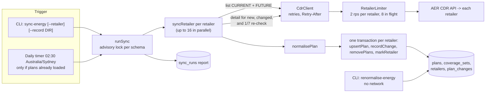
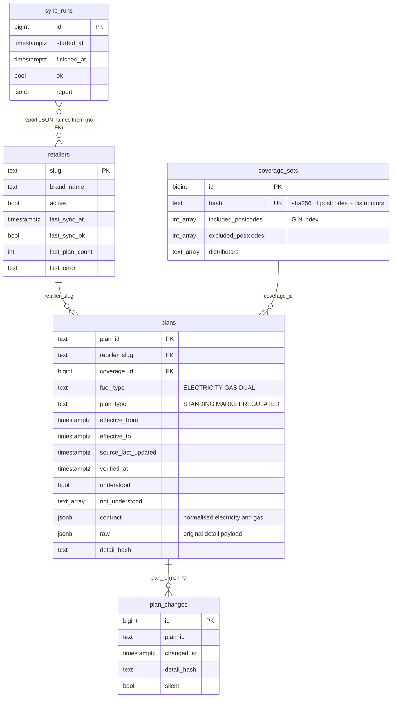
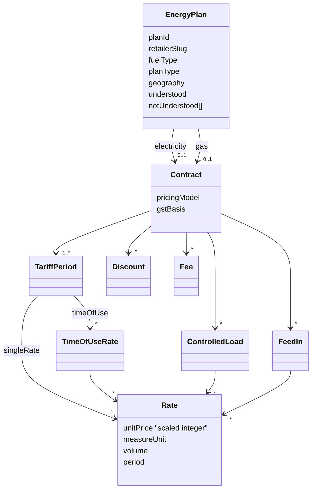
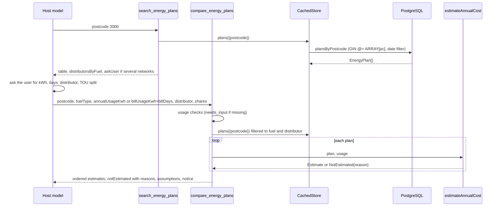

# Energy plans (vertical `energy`)

Answers "which electricity or gas plans are available at my postcode, and what would they cost me
for the usage on my bill?" from the AER's Consumer Data Right (CDR) product reference data.
This is the only vertical served on the public `/mcp` route.

Notes marked **(inferred)** are my reading of the code; **(unverified)** means the code or docs
leave it open. Read at commit `ff220c9`; nothing was run. Related detail docs:
[`../energy-data.md`](../energy-data.md), [`../energy-estimates.md`](../energy-estimates.md),
[`../cdr-schemas.md`](../cdr-schemas.md). Specs: `openspec/changes/add-energy-plan-data`,
`add-energy-plan-tools`, `add-mcp-server-core`.

## 1. Data: how it is loaded and refreshed

Source: `https://cdr.energymadeeasy.gov.au/{retailer}/cds-au/v1/energy/plans` (list `x-v: 1`,
detail `x-v: 3`), no authentication, reuse basis CDR Rules rule 2.6 (`energy-plans` in
`rights.json`, status `cleared`, review by 2027-02-01). Which retailers: `src/energy/retailers.json`,
currently **92** paths (see `docs/energy-data.md`). Project notes say only AGL had been loaded on the live VM
(727 plans on 15 Nov 2026). **(unverified)** from this repo which others have been loaded since.

Step by step (`src/energy/sync.ts`, `syncRetailer`):

1. **List.** `CdrClient.listPlans(slug, "CURRENT")` and `"FUTURE"`, following `links.next` on the same
   host only (`src/energy/cdr-client.ts`). Items go through `readListItem`; only
   `customerType === "RESIDENTIAL"` is kept (`isResidential`).
2. **Decide what to fetch.** Compare each item's `lastUpdated` with the stored `source_last_updated`
   (`storedState`). New or changed plans are fetched. Of the unchanged ones, the longest-unverified
   `ceil(total / 7)` are re-fetched as a **rolling re-check** (`recheckDays`, default 7).
3. **Fetch details** one by one for that retailer (`getDetail`). A 404 counts as `missingDetail`.
   Nothing is written until the retailer's data is complete.
4. **One transaction per retailer.** For each fetched plan `normalisePlan` produces the normalised
   model and `detailHash` (SHA-256 of key-sorted JSON of the raw detail, `src/energy/hash.ts`).
   - Re-check with an equal hash: only `verified_at` is bumped.
   - Re-check with a different hash while `lastUpdated` is unchanged: a **silent change**, written
     with `plan_changes.silent = true` and counted in the report.
   - Otherwise added or changed, with a `plan_changes` row.
   Plans no longer listed are deleted (`removePlans`); `markRetailer` records the plan count.
5. **Failure isolation.** On any error the retailer's transaction rolls back, its stored plans stay,
   and `retailers.last_error` is set. Other retailers continue. `sync_runs.ok` means "at least one
   retailer succeeded", so one failing retailer does not make all data look stale.
6. **Report.** `doSync` aggregates requests, throttling, plan counts per retailer and pricing model,
   plans not understood by reason, and table sizes into `sync_runs.report`; `formatReport` prints it.

Pacing (`src/energy/limiter.ts`): per retailer one request in flight and at most `rps` per second
(default 2, `ASKRIGHTO_SYNC_PER_RETAILER_RPS`); overall in flight capped at 8
(`ASKRIGHTO_SYNC_MAX_IN_FLIGHT`). A 429 halves that retailer's rate (`slowDown`, floor 0.1) and
`holdOff` honours `Retry-After`; 5xx and network errors retry with exponential backoff and jitter
(3 retries). `makeSyncDeps` in `src/energy/index.ts` wires the limiter into the client.

Scheduling (`startEnergy`, `src/energy/index.ts`): unless `ASKRIGHTO_SYNC_SCHEDULE=off`, a timer fires
daily at `ASKRIGHTO_SYNC_AT` (default `02:30`) in `ASKRIGHTO_SYNC_TZ` (default `Australia/Sydney`),
computed by `nextRunAt` (`src/energy/schedule.ts`, handles daylight saving). It runs `runSync` only if
`snap.plans > 0`, so **the server never performs the first load**: an operator runs `sync-energy`
once, and until then `/readyz` is 503 `no_data_loaded`. After a run the store cache is cleared and
the summary snapshot refreshed. If another instance holds the advisory lock the run is skipped.

Re-normalising without the network (`src/energy/renormalise.ts`, CLI `renormalise-energy`): a sync
re-normalises only plans whose source changed, so a normaliser fix or a change of
`GST_BASIS` (`src/energy/gst.ts`) reaches stored plans only through this command. It re-runs
`normalisePlan` over the stored `raw` payload, rewrites `understood`, `not_understood` and
`contract` where the key-order-free hash differs, supports `--dry-run` and `--show <reason prefix>`
(prints raw fragments of plans still flagged). The raw payload and `detail_hash` are untouched.
After running it the server must be restarted (or wait for a sync) to clear its cache; the CLI
says so.

Recent data-shape fixes (PR #13, `docs/cdr-schemas.md`):

- **Solar feed-in** `timeVaryingTariffs` is an **array** in detail v3 (it was an object in v2).
  `feedIn()` in `normalise.ts` reads the array, keeps the v2 object for tolerance, picks the shape
  from `tariffUType`, and stores windows in `FeedIn.timeVaryingTariffs`. This was the cause of the 21
  AGL plans flagged `solarFeedIn:unknown_shape` (issue #8).
- **Controlled load** supply charge is read from inside `singleRate` / each `timeOfUseRates[]`;
  block `period` is read from the block and copied to each rate.
- **GST basis** is `EXCLUSIVE` (`src/energy/gst.ts`), confirmed on AGL plan `AGD812605MR@VEC` against
  its fact sheet (rate x 1.1 = fact-sheet price). Fees are published GST-inclusive and costed as
  published; feed-in credits carry no GST. The basis is stored in each contract (`gstBasis`).

Other settings: `DATABASE_URL`, `DATABASE_SCHEMA`, `ASKRIGHTO_DB_POOL_MAX`, `ASKRIGHTO_DB_SSL`,
`ASKRIGHTO_CDR_BASE` (test override). Full table in `docs/energy-data.md`.

## 2. How the tables and objects are linked

(Table definitions: `src/energy/migrations/0001-init.ts`. `schema_migrations` is created by
`migrate` and is shared by all verticals.)

In code the same data is the `EnergyPlan` object (`src/energy/types.ts`):

Design points:

- **Money** is an integer in hundred-thousandths of a dollar (`MONEY_SCALE`, `src/energy/money.ts`);
  `parseMoney` reads CDR decimal strings without floats.
- **Coverage sets**: the postcode list of a plan is stored once (hash of sorted postcodes and
  distributors), so many plans share one row, and `included_postcodes @> ARRAY[pc]` uses the GIN index.
- **Understood flag**: the normaliser never coerces an unknown shape. It records a reason string
  such as `solarFeedIn:unknown_shape`, `pricingModel:X`, `tariffPeriod:banded_supply_charge`,
  `controlledLoad:no_rates`, `missing_contract`; `understood` is true only when there are none.
  Estimates refuse not-understood plans.
- Reads hide plans outside their effective dates (`plansByPostcode` and `planById` filter on
  `effective_from` / `effective_to` at read time).

## 3. Main functions and how they serve the end-to-end processes

### 3.1 Process: "What are the cheapest plans for my usage at postcode 3000?"

| Function | File | What it does for the process |
| --- | --- | --- |
| `startEnergy` | `src/energy/index.ts` | Opens the pool, builds `CachedStore`, registers dataset `energy-plans` (max age 48 h, stats: retailers, plans, failing retailers), adds readiness check `energy-plans` (schema >= 1 and plans > 0), arms the timer, sets the module runtime. With no `DATABASE_URL` it returns undefined and tools answer `data_unavailable`. |
| `withStore` | `src/energy/index.ts` | Wraps every energy read: no runtime or a database error becomes `notFound("data_unavailable", ...)`. Tools never answer from memory or another source. |
| `CachedStore.plans / plan` | `src/energy/store.ts` | 5-minute in-process cache keyed by the query JSON (cleared after a sync); `plan(id)` is uncached. |
| `plansByPostcode`, `planById`, `rowToPlan` | `src/energy/store.ts` | The only read SQL: join `plans` to `coverage_sets`, filter by postcode, exclusion, effective dates and optional fuel, retailer, plan type, distributor. |
| `searchEnergyPlans` (`search_energy_plans`) | `src/tools/search-energy-plans.ts` | Validates the postcode (`checkPostcode`), applies retailer match, fuel, plan type, distributor, solar feed-in and controlled-load filters, sorts, pages by cursor, and reports `distributorsByFuel` and `needsDistributor` so the host asks before comparing. Returns no costs. |
| `matchRetailer` | `src/tools/energy-common.ts` | Exact, then prefix or contains, then edit distance of at most two; several equal hits return `candidates` and a `needs_input`. |
| `uniqueDistributors` | `src/tools/energy-common.ts` | De-duplicates network names ignoring case (AGL writes "Citipower"). |
| `getEnergyPlan` (`get_energy_plan`) | `src/tools/get-energy-plan.ts` | One plan in full: periods, rates, windows, controlled load, feed-in, discounts with conditions, fees, eligibility, terms, plan link. Shows amounts including GST via `incGst`/`fmtRate`; withholds dollars if `gstBasis` were `UNKNOWN`; adds a warning when `understood` is false. |
| `compareEnergyPlans` (`compare_energy_plans`) | `src/tools/compare-energy-plans.ts` | Turns a bill (`billUsage` over `billDays`, scaled by 365/days) or a yearly figure into `Usage`; validates the peak/shoulder/off-peak shares sum to 100; requires a distributor when a postcode has several; filters by retailer, plan type or `planIds`; calls the calculator for each plan; orders estimates by cost; returns non-estimated plans with reasons, counts, assumptions and omissions. |
| `estimateAnnualCost` | `src/energy/calc.ts` | Pure function `(plan, usage) -> Estimate | NotEstimated`. Supply and usage per seasonal tariff period (365-day year, usage spread evenly by day); block rates per their period; time-of-use from the user's shares; controlled load; solar credit; guaranteed percentage discounts; recurring fees; GST on taxable parts when the basis is `EXCLUSIVE`. Each component is rounded once to the cent so `breakdownSum` equals the total. Conditional discounts are shown and excluded from the ordering (`totalIfConditionsMetCents` is separate). |
| `NotEstimatedReason` | `src/energy/calc.ts` | `demand_tariff`, `needs_time_of_use_split`, `not_fully_understood`, `no_controlled_load_rate`, `gst_basis_unknown`, `missing_rate`. |
| `inkviewResult` | `src/tools/energy-common.ts` | Builds an Inkview table or entity card, carries the grounded envelope under `grounded`, and falls back to the plain result if the component fails validation. |
| `asOfFor` | `src/tools/energy-common.ts` | The result's as-of date: last successful sync, else the oldest `verified_at` of the plans shown. |
| `ENERGY_INSTRUCTIONS` | `src/energy/instructions.ts` | Host guidance added on routes serving `energy` (search first; ask for kWh and days; ask for the split; ask the distributor; say "lowest estimate for the usage you gave"). |
| `energyVertical` | `src/energy/vertical.ts` | Registers the three tools, instructions and `start`. |

### 3.2 Process: operator refresh

`sync-energy` (CLI, `src/energy/cli.ts`: migrate, then `runSync`, print `formatReport`, exit code 1
on any failed retailer) or the nightly timer. After a normaliser or GST change:
`renormalise-energy --dry-run --show <reason>` then without `--dry-run`, then restart.

## 4. Known limits and open items

- **Retailer coverage**: 92 retailer paths seeded from the AER base URI document (Jan 2026); not yet
  compared with the CDR Register (task 1.4 of `add-energy-plan-data`), and only loaded once
  `sync-energy` has run for them.
- **AGL time-of-use**: AGL labels both bands `SHOULDER`, so `touCharge` throws
  `not_fully_understood` for its plans. Fixing it needs matching the user's split to bands by time
  window (a design change). `touCharge` also requires at most one PEAK and one OFF_PEAK band.
- **Not costed**: demand tariffs, banded supply charges, QUOTA pricing, several controlled-load
  tariffs, time-varying or volume-banded feed-in, discounts whose amount is not a percentage, one-off
  fees (listed under `notIncluded`).
- **Estimate accuracy** has not been compared with retailer fact sheets beyond the single AGL plan
  (docs list this as open). **(unverified)** accuracy claim.
- **Real fixtures**: one recorded plan (`test/fixtures/energy/recorded/agl-AGD812605MR.json`); the other
  fixtures are synthetic.
- **Scheduled sync does not re-normalise**: only `renormalise-energy` applies parser changes to
  plans whose source did not change.
- **Freshness**: results can be up to about a day old by design; the registry warns beyond 48 hours.
- Tests: `test/energy/*` (client, normaliser, calculator, DB, tools) and `test/e2e/server.test.ts`.

## Typical usage benchmark (add-energy-benchmark-usage)

When there is no bill, `compare_energy_plans` can use the AER's published typical household use for the postcode and household size (`useBenchmarkUsage` plus `householdSize`). The result is labelled typical, not the person's, and carries the zone, four seasonal values, source and release date. Time-of-use plans stay not estimated; controlled load and solar are left out. Data, lookup rule and limits: [`../energy-benchmarks.md`](../energy-benchmarks.md). Rights entry: `aer-benchmarks`.

