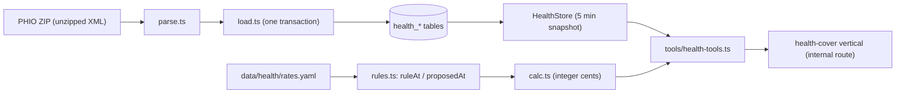

# Private health cover

Internal-only vertical `health-cover` (change ids `add-health-cover-data`, `-rates`, `-tools`, `-skills`, `-evaluation`; research in [`../health-cover-research.md`](../health-cover-research.md)). Written 17 November 2026 from the code; the product file has never been opened, so the parser reads an assumed layout ([`../health-cover-columns.md`](../health-cover-columns.md)).

## 1. Data and refresh

| Part | Source | Where it lives | Refresh |
| --- | --- | --- | --- |
| Products | PHIO monthly ZIP, CC BY 3.0 AU | `health_*` tables (migration `0005-health.ts`) | Operator runs `health:load` monthly; one transaction replaces all rows; `health_loads` records file name, date, hash |
| Rules | ATO and Department of Health pages, re-keyed | `data/health/rates.yaml`, read into memory at start | Hand review each 1 April and 1 July (`reviewBy`); `release:check` and `health:rates-validate` fail on an overdue row |

Product results carry the file date; a warning is added when the file predates the latest 1 April or 1 July. Rules results carry the ATO page's updated date.

## 2. How the parts link

`rules.ts` never returns a `proposed` row for a calculation. `calc.ts` works in whole cents and thousandths of a per cent and rounds once.

## 3. Functions and processes

| Function | File | Does |
| --- | --- | --- |
| `parseHealthDir`, `HealthAccumulator` | `src/health/parse.ts` | Streams the real PHIO XML (700 MB files) product by product; open products only unless asked; problems collected, repeated ProductIDs reported |
| `loadHealth`, `HealthStore` | `src/health/load.ts` | Replace-all load; cached read |
| `loadRates`, `ruleAt`, `proposedAt`, `overdueRules` | `src/health/rules.ts` | Validate and select dated rules |
| `estimateRebate`, `estimateSurcharge`, `estimateLhc`, `tierFor` | `src/health/calc.ts` | Pure calculators returning `NotEstimated` with a reason |
| Seven tools | `src/tools/health-tools.ts` | search, get, compare, premium after rebate, surcharge break-even, loading, rules |
| `startHealth` | `src/health/index.ts` | Registers datasets and readiness; works without a database for the rules |

Not-estimated reasons (`rules_out_of_range`, `rebate_basis_unclear`, `base_day_unclear`, `needs_input`) travel as `outside_coverage` or `needs_input` with `details.calcReason`.

## Known gaps

- Layout unverified (see the columns page). Hospital agreements, rollback to the previous load, and the coverage-report health case are not built.
- Legal view, site terms and the ATO licence are outstanding; both datasets are `cleared_pending_legal_view`.
- The MLS exemption excess limit is not stored because it was not confirmed; results point to the ATO page.
