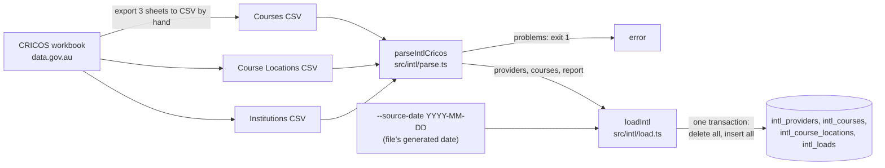
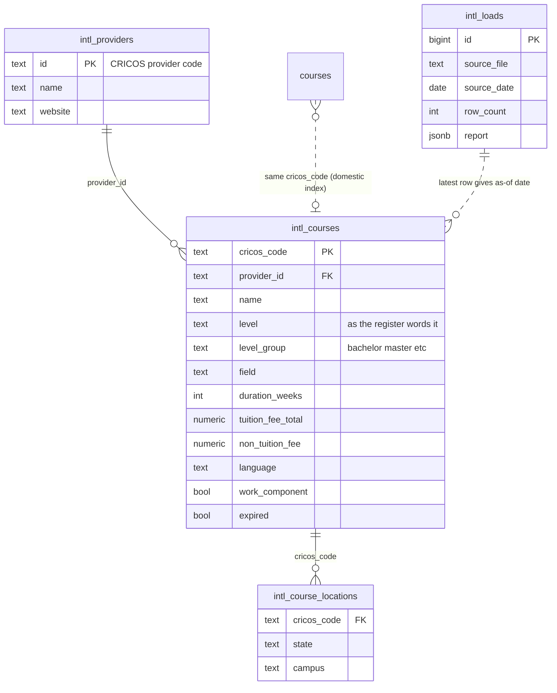
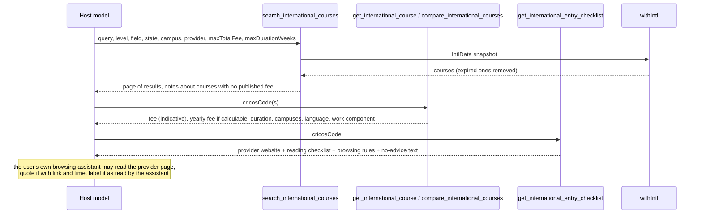

# International student courses (vertical `cricos`)

Answers "which higher-education and VET courses registered for international students match my field,
level, state or budget, and what does CRICOS say about duration, fee and campus?" It gives no
visa, migration, work-rights or post-study advice. **Internal route only** until promoted.

Notes marked **(inferred)** are my reading of the code; **(unverified)** means the code or docs
leave it open. Read at commit `ff220c9`; nothing was run. Related docs:
[`../intl-course-data.md`](../intl-course-data.md), [`../cricos-columns.md`](../cricos-columns.md),
[`../use-case-comparison/`](../use-case-comparison/protocol.md). Specs: `openspec/changes/add-intl-course-data`,
`add-intl-course-tools`, `add-course-use-case-comparison`.

## 1. Data: how it is loaded and refreshed

Source: the national CRICOS register (CC BY 2.5 AU, Australian Government Department of Education,
via data.gov.au). Rights entries: `intl-courses` and `cricos-register`, both `cleared` (`src/core/rights.json`).
CRICOS is a spreadsheet with several sheets; `docs/cricos-columns.md` records the layout of the
file dated 1 Oct 2026, checked on 16 Nov 2026.

Commands (`src/intl/cli.ts`; both need `--cricos`):

- `intl:validate --cricos courses.csv [--course-locations ...] [--institutions ...]` parses and prints
  the report; writes nothing.
- `intl:load ... [--source-date YYYY-MM-DD]` runs `migrate`, then `loadIntl`. The source date is
  **given, not guessed**: without the flag it falls back to the file's modified time, which would
  show a wrong as-of date (the docs say to pass the register's own date).

`parseIntlCricos` (`src/intl/parse.ts`):

1. `fromHeader` skips the two title rows above each sheet's header (it looks for the first row in
   the opening rows that names a known column). Column names are matched loosely after lower-casing
   and stripping punctuation, from lists in `HEADERS`.
2. Required columns: course code, provider code, course name, level; if one is missing the parse
   returns `problems` and nothing loads. Other missing columns are reported in `columnsMissing` and
   show as "not published".
3. `levelGroupOf` keeps associate degree, bachelor (including honours), graduate certificate, graduate
   diploma, master, doctorate, diploma, advanced diploma and Certificate I to IV (literal matches). School,
   Non AQF Award and Vocational Short Course rows are counted in `excludedByLevel` and not stored. Each
   course gets a `sector` and the VET National Code as published (a diploma with no code has no stated sector).
4. Duplicate course codes: the first row wins and the code is listed in `duplicateCodes`.
5. Locations come from the Course Locations sheet joined on `providerCode|courseCode` (campus is
   "name, city" unless the name already holds the city). Without that sheet the Courses sheet's own
   `locations` column is used if present. Websites come from the Institutions sheet joined on
   provider code; `normaliseWebsite` adds a scheme to bare hosts and drops values without a dot.
6. `expired` is true for `Yes` or a past date.

`loadIntl` refuses an empty course list and a non-ISO date, then in **one transaction** deletes all
three data tables and re-inserts, then appends an `intl_loads` row (source file, source date, git
sha, row count, parse report). A failed load rolls back and leaves the old rows. There is no
incremental update and no timer: refresh means repeating the manual export and load when a new
CRICOS file is published. Cadence is not set in the repo **(unverified)**; the dataset's
`maxAgeHours` is 90 days (`startIntl`), after which results carry a staleness warning.

First real parse (16 Nov 2026, per `docs/cricos-columns.md`): 13,069 courses from 664 providers kept
of 25,971 rows. Whether that file has been **loaded into the shared database** is **(unverified)**
from this repo; the project notes say the real file was opened on a machine that reaches data.gov.au.

Serving side: `IntlStore.data()` reads all four tables into an `IntlData` snapshot cached for five
minutes, under a 3-second statement timeout (`STATEMENT_TIMEOUT_MS`). No row in `intl_loads` throws
`NoIntlLoad` and tools answer `data_unavailable`.

## 2. How the tables and objects are linked

- The international tables are **separate from the domestic `courses` table** by design (own
  migration `0004-intl.ts`, own rights entry, own vertical), so international facts cannot leak into
  domestic answers.
- The only link is the CRICOS course code. `IntlStore.data()` runs a sub-select
  (`SELECT c.id FROM courses c WHERE c.cricos_code = i.cricos_code LIMIT 1`) to fill
  `IntlCourse.domesticCourseId`, which `get_international_course` shows as "Also in the domestic index as ...".
  This needs migration 2 applied even for an international-only deployment because it queries
  `courses`. **(inferred)** `INTL_REQUIRED_SCHEMA` is 4 and migrations are applied in order, so
  `courses` exists whenever the schema is current.
- In memory: `IntlData { providers, courses, sourceDate, sourceFile, loadedAt }` and
  `IntlCourse { ..., locations[], domesticCourseId? }` (`src/intl/types.ts`).
- Unpublished facts stay `undefined`/null; nothing is inferred. Fees are labelled
  "Indicative, as published in CRICOS" with the file date; a yearly fee is shown only when the total
  fee and the duration are both published, labelled "calculated: total fee divided by duration"
  (`yearlyFee` in `src/tools/intl-tools.ts`).

## 3. Main functions and the end-to-end processes

### 3.1 Process: "Which master's courses in IT in Victoria cost under a given amount?"

| Function | File | What it does |
| --- | --- | --- |
| `startIntl` | `src/intl/index.ts` | Opens the pool (3 s statement timeout), builds `IntlStore`, registers dataset `intl-courses` (as-of is the CRICOS source date; stats: courses, providers), adds readiness check `intl-courses` (schema >= 4 and courses > 0). |
| `withIntl` | `src/intl/index.ts` | Wraps reads; missing runtime, `NoIntlLoad` or database error becomes `data_unavailable`. |
| `IntlStore.data` | `src/intl/load.ts` | Reads providers, courses with the domestic join, locations and the latest load into one cached snapshot. |
| `searchIntlCourses` (`search_international_courses`) | `src/tools/intl-tools.ts` | Drops expired courses; filters by words in course or provider name, level group, field substring, state, campus, provider, `maxDurationWeeks` (courses with no duration are left out) and `maxTotalFee` (courses with no published fee are **not** counted as under it, and the count is reported in a note). Pages by cursor. |
| `getIntlCourse` (`get_international_course`) | same | One course in full via `viewOf`; adds a warning if the course is marked expired. |
| `compareIntlCourses` (`compare_international_courses`) | same | Side by side on the same published fields, no winner. |
| `checkIntlEntryChecklist` (`get_international_entry_checklist`) | same | Despite the export name, the tool is `get_international_entry_checklist`. Returns provider website, `INTL_READING_CHECKLIST` (English requirement, entry requirements by country, intake and deadline, provider-listed fee and scholarships, page date), `INTL_BROWSING_RULES` and `INTL_NO_ADVICE`. Ask Righto holds none of these facts and fetches no pages. |
| `okResult` | same | Wraps results in `found` with source `CRICOS_SOURCE`, as-of = CRICOS source date, and `INTL_NOTICE`. |
| `INTL_INSTRUCTIONS`, `INTL_NOTICE`, `FEE_LABEL`, `INTL_NO_ADVICE` | `src/intl/instructions.ts`, `notice.ts` | Wording rules; fees as indicative; Home Affairs pointer. |

## 4. Known limits and open items

- **Level scope**: higher education plus diploma, advanced diploma and Certificate I to IV (decided 20 Nov 2026). Non AQF Award (1,707), Vocational Short Course (39) and school levels stay out.
- **No entry facts**: English tests, country-based entry requirements, intakes, scholarships and
  provider fee pages are outside CRICOS; they are only reachable through the guided-browsing
  checklist, which is untested against real provider sites **(unverified)**.
- **Fee quality**: tuition fee is a course total, blank on some courses (126 among kept levels on the
  checked file). A zero fee is treated as unpublished by the parser (`tuition ? ... : {}`).
  **(inferred)** that is harmless but undocumented.
- **No automation**: manual export and load; no check that a newer CRICOS file exists.
- **Thresholds** for promotion (80% grounded answers, 45 days of source age) are drafts in the
  comparison protocol, not enforced in code.
- Tests: `test/intl/*` (parse, DB, tools, prompts) with fixtures in `test/fixtures/cricos/`.
