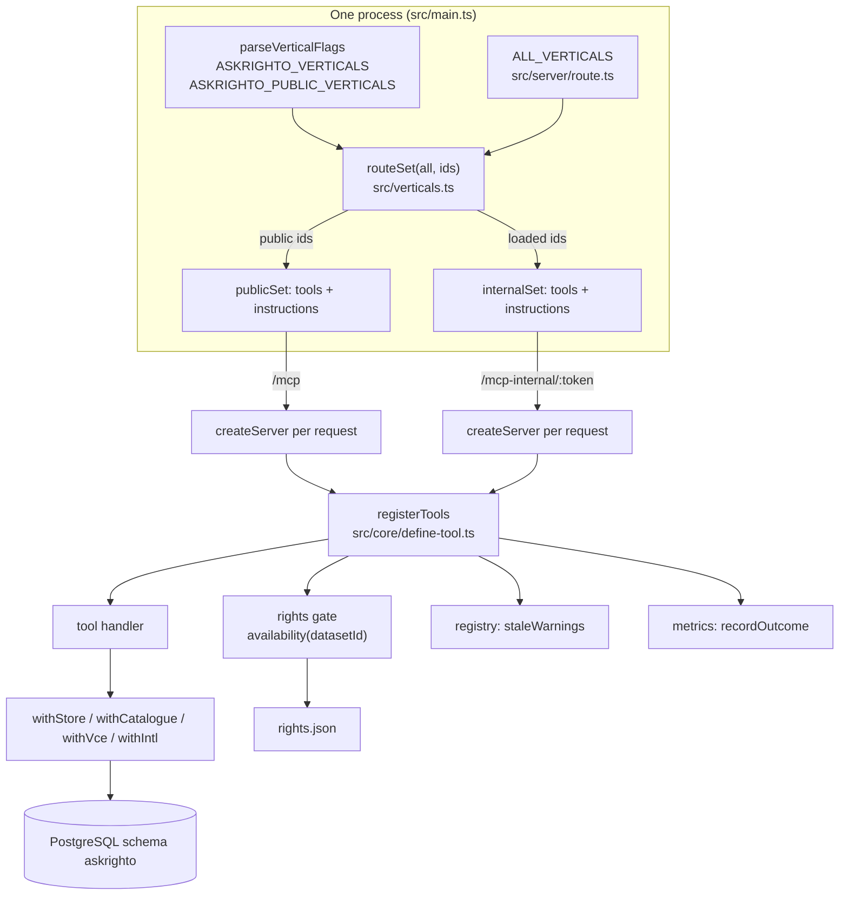
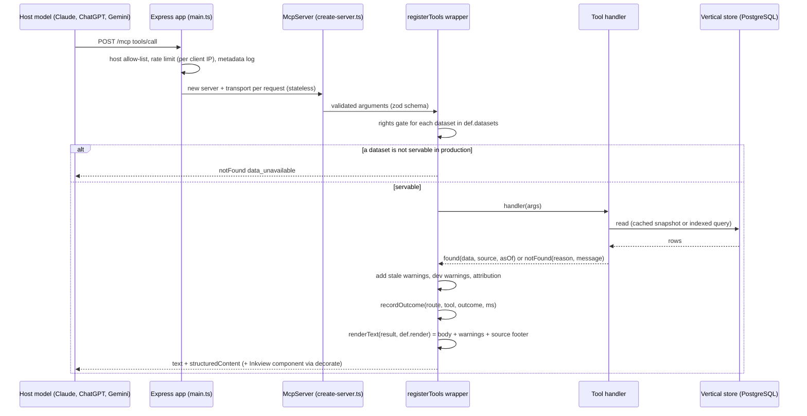

# Platform: server, tools, data rights and release channels

The shared layer every vertical (energy, courses, international) sits on. Read this first; the
other area docs assume it.

How to read the notes: everything here was read from the code at commit `ff220c9` (main after
PR #17). Nothing was run to write it. Statements marked **(inferred)** are my reading of how the
parts fit; **(unverified)** means the code or docs leave it open.

## 1. Data: loading and refresh

The platform owns no dataset. It owns the *mechanisms* that datasets plug into:

| Mechanism | File | What it does |
| --- | --- | --- |
| Database pool and migrations | `src/energy/db.ts` | `dbConfig` reads `DATABASE_URL` and `DATABASE_SCHEMA` (default `askrighto`); `assertSchema` refuses any schema not named `askrighto` or `askrighto_*`; `createDb` makes a small pool (default 5) whose `search_path` is the schema, optionally with a statement timeout; `migrate` applies pending `MIGRATIONS` each in its own transaction under an advisory lock; `schemaCurrent(db, n)` is what readiness checks use. The file lives under `energy/` for historical reasons, but all verticals import it. |
| Migrations | `src/energy/migrations/0001..0004` | 1 energy, 2 courses, 3 VCE admissions, 4 international. Embedded in the bundle as TypeScript strings, so the container needs no SQL files. No down migrations. |
| Dataset registry | `src/core/registry.ts` | `registerDataSet` records id, title, publisher, source, coverage, `refreshedAt()`, `maxAgeHours`, optional `stats()` and the owning `vertical`. Feeds `list_data_sources` and stale-data warnings. |
| Readiness checks | `src/core/readiness.ts` | `addReadinessCheck(name, check, vertical)`; `/readyz` runs the public verticals' checks. |
| Rights register | `src/core/rights.json`, `src/core/rights.ts` | Machine copy of `docs/data-rights.md`. See section 3.3. |
| Reference files | `data/` (YAML), read at run time via `ASKRIGHTO_DATA_DIR` (the image sets `/app/data`) | Only the course and VCE loaders read them, and only from the command line, never while serving. |

Refresh is therefore per vertical, not central: energy has a daily timer plus a CLI sync;
courses, VCE and international are loaded by hand from the CLI and have no timer. See each
area doc.

Start-up order in `src/main.ts` (HTTP mode): `startVerticals()` reads the flags, calls each
vertical's `start(env)` (which opens its own pool, registers its datasets and readiness check),
then the Express app is built from the route sets. `migrate` is a separate CLI command run by the
deploy playbook before the container starts (`docs/deploying.md`).

## 2. How the objects are linked

Key relationships:

- A **vertical** (`src/verticals.ts`, interface `Vertical`) bundles `id`, `tools`, `instructions`
  and `start(env)`. Three exist: `energy` (`src/energy/vertical.ts`), `courses`
  (`src/courses/vertical.ts`), `international` (`src/intl/vertical.ts`). `KNOWN_VERTICALS` is the
  closed list.
- A **tool** (`ToolDefinition`) names the dataset ids it reads in `datasets`. Those ids tie the
  tool to the registry (staleness) and the rights register (gate and attribution).
- A **route set** (`RouteSet`) is the tools and instruction texts of the verticals one route may
  show. `routeSet` also appends a per-route `list_data_sources` built by `makeListDataSources(ids)`,
  which lists only datasets whose `vertical` is in that route's ids.
- A vertical that fails to start is recorded by `markVerticalFailed`; `routeSet` then replaces its
  tools with `stub()` versions that answer `data_unavailable`. A *public* vertical failing stops
  start-up instead (`startVerticals` in `src/main.ts`).

## 3. Main functions and the end-to-end process

### 3.1 From tool call to answer

| Function | File | Role in the flow |
| --- | --- | --- |
| `createMcpExpressApp`, `hostHeaderValidation` | `@modelcontextprotocol/express`, used in `src/main.ts` | HTTP app and DNS-rebinding guard on `/mcp`, `/mcp-internal`, `/readyz-internal`, `/metrics-internal` (`GUARDED`). |
| `RateLimiter.take`, `clientKey` | `src/server/limits.ts` | Fixed-window limit per client; the client key is the trusted proxy header (`ASKRIGHTO_CLIENT_IP_HEADER`, for example `cf-connecting-ip`) or the socket IP. 429 with `Retry-After`. |
| `describeRpc`, `logLine` | `src/server/limits.ts` | The only request facts logged: method, path, status, ms, JSON-RPC method, tool name. `maskInternalPath` hides the token. |
| `serve(set, route)` | `src/main.ts` | Per request: `createServer(set.tools, {route, instructions})`, a `NodeStreamableHTTPServerTransport` with no session id, closed on response end. |
| `createServer` | `src/server/create-server.ts` | Builds `McpServer` with `serverInstructions(...)`, then `registerInkview` and `registerTools`. |
| `serverInstructions` | `src/server/instructions.ts` | `baseInstructions()` (shared rules, see skills doc) + each served vertical's guidance text. |
| `defineTool`, `validateToolDefinition` | `src/core/define-tool.ts` | Tool names are verb-first snake_case (`TOOL_VERBS`), annotations are mandatory, inputs must be flat (scalars, enums, arrays of scalars). Violations throw at server start. |
| `registerTools` | `src/core/define-tool.ts` | The wrapper above: rights gate, error trap (`isError` with a fixed message, no arguments logged), staleness and attribution merge, metrics, text rendering. |
| `found`, `notFound`, `renderText`, `sourceFooter` | `src/core/grounded.ts` | The envelope. `found` throws if source name, URL, licence or a valid `asOf` is missing. `NotFoundReason` is a closed set: `not_in_dataset`, `outside_coverage`, `no_data_loaded`, `data_unavailable`, `needs_input`. |
| `staleWarnings`, `oldestRefresh` | `src/core/registry.ts` | Warn when a dataset has never loaded or is older than `maxAgeHours`. (`oldestRefresh` is exported and tested but has no caller in `src/`.) |
| `availability`, `assertRegistrable`, `attributionFor`, `overdueReviews` | `src/core/rights.ts` | Rights gate, start-up check, attribution text, review-by check. |
| `recordOutcome`, `metricsText` | `src/core/metrics.ts` | In-memory counters and latency buckets per route and tool, shown at `/metrics-internal/<token>`. Counts only. |
| `runReadiness` | `src/core/readiness.ts` | `/readyz` (public verticals) and `/readyz-internal/<token>` (all loaded, plus failed verticals). |

### 3.2 Release channels (canary)

Introduced by change `add-canary-release`. One image, one instance, two routes:

| Route | Serves | Auth |
| --- | --- | --- |
| `/mcp` | verticals in `ASKRIGHTO_PUBLIC_VERTICALS` (default: everything loaded) | none |
| `/mcp-internal/<token>` | every loaded vertical | token in the path, compared by `tokenMatches` (SHA-256 digests with `timingSafeEqual`) |
| `/readyz`, `/readyz-internal/<token>`, `/metrics-internal/<token>` | public readiness; internal readiness; counters | token for the internal ones |
| `/healthz` | liveness only, never touches the database | none |

Behaviour worth knowing:

- A missing, wrong or unset `ASKRIGHTO_INTERNAL_TOKEN` gives **404**, so the route's existence is
  not confirmed (`src/main.ts`, middleware using `INTERNAL_PATH`). The token must be 43+ characters
  or start-up throws.
- Each request builds its server from its own route's set, so a public client cannot list or call an
  internal-only tool, read its instructions, or see its datasets in `list_data_sources`.
- The intended production setting (docs/deploying.md, "Infra handoff") is
  `ASKRIGHTO_VERTICALS=energy,courses`, `ASKRIGHTO_PUBLIC_VERTICALS=energy`,
  `ASKRIGHTO_ENV=production`. The `international` vertical is added to the loaded list the same
  way. **(unverified)** I could not see the feima-infra repo, so whether those values are set on the
  live VM is not known from this repo.
- Promotion to public is a settings change guarded by `docs/promotion-checklist.md` (rights cleared,
  review dates current, launch criteria, two weeks of internal counts, Iven's written go).
- `stdio` mode (`src/main.ts`, the final `else`) starts only `startEnergy()` and calls
  `createServer()` with the default `allTools` (three energy tools plus `list_data_sources`). The
  course and international tools do not exist in stdio. It is documented as development-only.

### 3.3 Data rights gate

`src/core/rights.json` holds one entry per dataset: owner, `basis` (`open_licence`, `cdr_rule`,
`written_permission`, `own_words_facts`), `status`, evidence with read dates, `attribution`,
`conditions`, `reviewBy`, optional `dataGlobs` and `domains`. `parseRights` validates it at import.

| Status | Served in production? |
| --- | --- |
| `cleared`, `cleared_pending_legal_view` | yes |
| `pending`, `refused`, `withdrawn` | no: the tool answers `data_unavailable` |

In development the gate serves everything but adds a warning ("shown for development only").
Production means `ASKRIGHTO_ENV=production`, or `NODE_ENV=production` when `ASKRIGHTO_ENV` is unset
(`isProduction`); the Docker image sets `NODE_ENV=production`.

Current register (from `rights.json`, read 16 Nov 2026): `energy-plans`, `cricos`, `intl-courses`
are `cleared`; `vic-courses`, `vce-key-dates`, `vtac-preference-rules`, `vic-early-entry` are
`cleared_pending_legal_view`; `vce-scaling`, `vce-study-groupings`, `vtac-coursesearch`,
`course-seeker` are `pending` (written permission not yet recorded). The `dataGlobs` on the two
pending VCE tables name files that must not be committed (`data/vce/scaling-*`,
`data/vce/study-groupings-*`); the course YAML validator uses `domains` to refuse sources on
`vtac.edu.au` and `courseseeker.edu.au` while those entries are not cleared
(`src/courses/validate.ts`). `npm run release:check` (`scripts/release-check.mjs`) fails on overdue
review dates and notes datasets waiting on the legal view; CI runs it.

## 4. Build, test and deploy

- `scripts/build.mjs`: esbuild bundles `src/main.ts` to one file `dist/askrighto.js` (ESM, node20
  target) so the image needs no `node_modules`.
- `Dockerfile`: two stages, runs as `node`, copies `data/` into `/app/data`. `data/local/` is
  git-ignored and never reaches the image.
- `.github/workflows/ci.yml`: Node 20 and 22 against a Postgres 16 service (`TEST_DATABASE_URL`):
  typecheck, lint, `npm test` (build, then vitest including `test/e2e/server.test.ts` which spawns
  the bundle), `courses:validate`, `vce:validate`, `guidance:check`, `release:check`.
- `.github/workflows/image.yml`: pushes `ghcr.io/feimacode/askrighto` (`:latest`, `:sha-...`,
  `:x.y.z`), smoke-tests `/healthz`. Roll out and roll back are described in
  [`../deploying.md`](../deploying.md).

## 5. Gaps and cautions

- `src/energy/db.ts` and `migrations/` hold shared database code under an `energy` folder name. Moving
  them is cosmetic, but a new reader will look in the wrong place. **(inferred)** low priority.
- Counters are in memory and reset on restart, so they cover only the current container's life.
