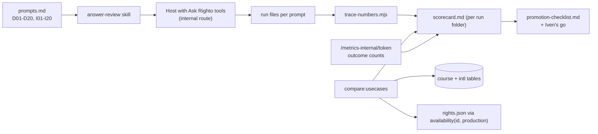

# Review and comparison tooling

Two maintainer-only pieces that check the product rather than serve users: the **coverage report**
(`compare:usecases`) and the **answer-review skill** with its **number trace**. They support the
promotion gates in [`../promotion-checklist.md`](../promotion-checklist.md) and
the decision between the domestic and international course verticals. Neither is exposed through
the MCP server.

Notes marked **(inferred)** are my reading of the code; **(unverified)** means the code or docs
leave it open. Read at commit `ff220c9`; nothing was run. Specs:
`openspec/changes/add-course-use-case-comparison`, `add-answer-review-skill`.

## 1. Data: what they read and how they refresh

| Tool | Reads | Writes | Refresh |
| --- | --- | --- | --- |
| `compare:usecases [--json]` (`src/compare/cli.ts`, `coverage.ts`) | our own tables (`courses`, `course_*`, `intl_*`, `*_loads`) and the rights register | nothing (read-only) | none: computed on each run from whatever is loaded |
| `ask-righto-answer-review` skill (`.claude/skills/...`) | prompt sets in `docs/use-case-comparison/prompts.md`, run files you save | `docs/use-case-comparison/runs/<date>-<host>/` (folder does not exist yet) | manual, per host run |
| `scripts/trace-numbers.mjs` | one run file `{prompt, toolResults[], answer}` | stdout; exit 1 on an untraced figure | none |

## 2. How the objects are linked

`test/intl/prompts.test.ts` parses `prompts.md` and checks that each set has 20 prompts and that every
expected tool name is a registered tool across all verticals.

## 3. Main functions and the end-to-end process

### 3.1 `compare:usecases`

`coverageReport(db)` returns `{ generatedAt, domestic, international }`.

- `domesticCoverage`: if the `courses` table is missing, returns an empty report. Otherwise counts
  courses, curated versus index-only, and the share with an official link, CRICOS code and so on
  (`share(count, of)` gives a percent), the age in days of the last `course_loads` row, and the
  production readiness of six datasets.
- `intlCoverage`: counts courses and providers, courses by level group, the share with a published
  tuition fee, duration, language, location, provider website and with a match in the domestic index
  (`inDomesticIndex`), the source file and date and its age, `columnsMissing` from the last load
  report, and production readiness of `intl-courses`.
- `datasetsFor(ids)` calls `availability(id, {ASKRIGHTO_ENV: "production"})` so the report shows
  what **would** be served in production today, whatever environment it runs in.
- `formatReport` prints the plain-text version; `--json` prints the object.

### 3.2 Answer review (maintainer process)

1. Choose the domestic (D01 to D20) or international (I01 to I20) set and the host, and say whether a
   browsing assistant is on.
2. Run each prompt on a host connected to `/mcp-internal/<token>`; save `{prompt, toolResults,
   answer}` per prompt.
3. `traceNumbers({prompt, toolResults, answer})` extracts numbers with `/\d[\d,]*(?:\.\d+)?/`,
   normalises them (`canon`: commas removed, trailing zeros trimmed) and returns every figure in the
   answer that appears in neither the prompt nor any tool result. Leading list markers (`1.`) are
   ignored in the answer. It is deliberately strict, so rounded figures are flagged; the reviewer
   judges each flag by hand.
4. Check wording by hand: "best" or "recommended", odds of entry, aggregate-to-ATAR conversion,
   visa advice, expected tools called.
5. Fill the scorecard (`docs/use-case-comparison/scorecard.md`): per-prompt grounded yes/no and
   completeness (without browsing, with browsing, not answerable), plus the data-side measures from
   `compare:usecases`.
6. Draft decision rules (not enforced in code): rights readiness passes in production mode, at least
   80 percent grounded, no ungrounded figure, source under 45 days old; promotion still needs the
   checklist and Iven's go.

## 4. Known limits and open items

- No real host run has been recorded; the scorecard is empty.
- The protocol's "Known gaps" says the international columns are unverified until
  `docs/cricos-columns.md` is filled in. That file has since been filled in (verified 16 Nov 2026),
  so that bullet is **stale** **(inferred)**.
- Browsing assistants on a person's own browser are untested against university and provider pages.
- Thresholds are drafts awaiting Iven's confirmation.
- Tests: `test/trace-numbers.test.ts`, `test/intl/prompts.test.ts`.
