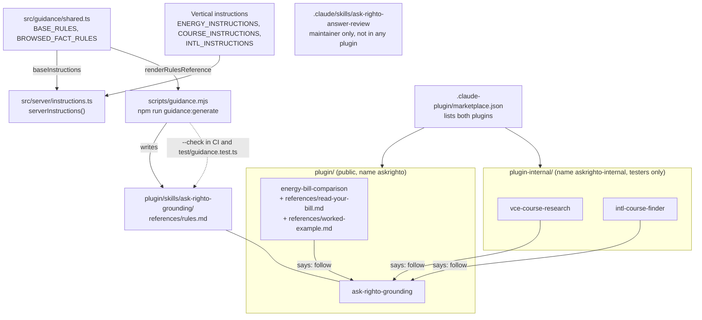
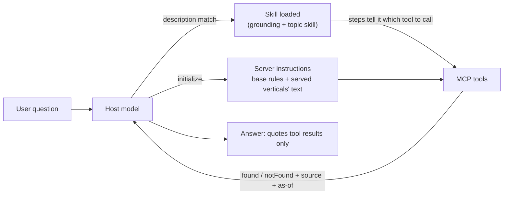

# Skills and plugins

Ask Righto ships two kinds of guidance to the host model: **server instructions** (sent on every
MCP `initialize`) and **skills** (`SKILL.md` files in two plugin bundles). Both exist because hosts
differ in how well they honour server instructions, and a skill can carry multi-turn intake and
wording the instructions cannot. Skills carry **no data and no tools**; every fact still comes from
a tool result.

Notes marked **(inferred)** are my reading of the code; **(unverified)** means the code or docs
leave it open. Read at commit `ff220c9` (PR #17 merged); nothing was run. Specs:
`openspec/changes/add-host-guidance`, `add-energy-bill-skill`, `add-course-skills`,
`add-answer-review-skill`. Activation tests to run by hand: [`../skills/activation-prompts.md`](../skills/activation-prompts.md).

## 1. What is in the repo and how it is refreshed

| Piece | Path | Notes |
| --- | --- | --- |
| Public plugin | `plugin/.claude-plugin/plugin.json`, `plugin/skills/` | Name `askrighto`, version 0.1.0. Skills: `ask-righto-grounding`, `energy-bill-comparison`. Safe to list: energy is the only public vertical. |
| Internal plugin | `plugin-internal/.claude-plugin/plugin.json`, `plugin-internal/skills/` | Name `askrighto-internal`. Skills: `vce-course-research`, `intl-course-finder`. Its manifest says it is for testers while the course tools are internal-only, to be installed alongside the public plugin. Not for public listing. |
| Marketplace | `.claude-plugin/marketplace.json` | One marketplace named `askrighto` with both plugins as relative sources (`./plugin`, `./plugin-internal`). |
| Maintainer answer-checker | `.claude/skills/ask-righto-answer-review/SKILL.md`, `scripts/trace-numbers.mjs` | Project-level skill for people working in this repo; it is not in either plugin, so users never get it. See [`review-and-comparison.md`](review-and-comparison.md). |
| Shared rules | `src/guidance/shared.ts` | The single source of the base rules sent as server instructions **and** written into the grounding skill's reference. |
| Generator | `scripts/guidance.mjs` | Bundles `shared.ts` with esbuild, imports it, and writes (or with `--check`, compares) `plugin/skills/ask-righto-grounding/references/rules.md`. |

How it is refreshed: edit `src/guidance/shared.ts`, run `npm run guidance:generate`, commit both
files. CI runs `npm run guidance:check` and `test/guidance.test.ts` runs the same check, so a stale
`rules.md` fails the build. The vertical instruction texts and the skill steps are **separate hand-
written copies** of similar advice (for example "ask for kWh and days"); only the base rules are
generated. **(inferred)** these can drift, and the tests below catch only some kinds of drift.

Plugins are copied to a cache when installed, so a plugin folder must not reference paths outside
itself (`add-host-guidance` design); that is why `rules.md` is generated into the plugin rather than
linked to `src/`.

There is no runtime loading: skills are files the host reads after the user installs the plugin.
Installation, listing in the Claude directory, the ChatGPT plugin ZIP and Gemini registration are
packaging steps that are **(unverified)** in this repo; project notes say activation prompts have not
been run on real hosts and the ChatGPT conversion is untried.

## 2. How the pieces are linked

- **Skill to skill**: each topic skill states "follow the `ask-righto-grounding` skill for how to
  quote results"; the grounding skill points to `references/rules.md` for the rules about facts read
  from an official page (`BROWSED_FACT_RULES`).
- **Skill to tool**: skills name tools in backticks. `test/guidance.test.ts` checks that every
  `get_`/`search_`/`compare_`/`list_`/`check_`/`estimate_` name in any skill markdown exists among the
  registered tools (energy tools plus the course and international verticals' tools).
- **Skill to vertical**: the energy skill is public because the energy vertical is; the course
  skills sit in the internal plugin because those verticals are internal-only. A test asserts the
  public bundle has no skill whose name contains "course".
- **User first**: every skill says "If the user gives different instructions, follow the user"; the
  grounding skill is tested for it.

## 3. The skills and what each does

| Skill | Triggers on (from its `description`) | Process it drives |
| --- | --- | --- |
| `ask-righto-grounding` | Any time an Ask Righto result is about to be quoted, summarised or compared, or a tool found nothing | Call the tool before saying anything factual; quote figures exactly with source name, link and as-of date; relay `found: false` plainly and give any official link; describe what the data shows, never "best" or "recommended"; for pages the host reads for the user, follow `references/rules.md`. |
| `energy-bill-comparison` | Comparing electricity or gas plans, paying less on a power bill, retailers for a postcode | 1 postcode then `search_energy_plans`; 2 ask distributor if several; 3 ask kWh and days from a bill (never assume usage); 4 time-of-use split; 5 solar and controlled load; 6 `compare_energy_plans`; 7 answer as "lowest estimate for the usage you gave", pass on assumptions, discount conditions, the notice and plan links. Non-estimated plans: give the reason and link, never work out a cost. References: how to read a bill, and a worked example labelled invented with no currency amounts (tested). |
| `vce-course-research` (internal) | Victorian VCE student or parent asking about courses, prerequisites, entry figures, VTAC dates, early entry, aggregate | `search_domestic_courses` first; ask studies before `check_domestic_course_prerequisites`; scores only for a scored check or aggregate; quote figures with kind and intake year; an aggregate is not an ATAR; describe early entry, never say eligible; never "will get in", odds, or choosing subjects; index-only courses: links, and if browsing, read only the checklist, university page first, then Course Seeker, never VTAC; stop at a bot check. |
| `intl-course-finder` (internal) | International student or family asking about CRICOS courses, providers, fees, duration, entry checklists | `search_international_courses` first; `get_international_course` and `compare_international_courses`; fees always "indicative, as published in CRICOS" with file date; never convert currency or add fees; use `get_international_entry_checklist` for what Ask Righto does not hold; no visa, migration, work-rights or post-study advice (point to Home Affairs); no ranking. |

### 3.1 Server instructions (the other half)

`serverInstructions(verticalTexts)` in `src/server/instructions.ts` joins `baseInstructions()` (the
four `BASE_RULES`), then the instruction text of each vertical **the route serves**, then any text
added with `addInstructions`. The public route therefore receives only the energy guidance; the
internal route also receives the course and international guidance. Skills reinforce this but the
instructions are the part that every host receives with the connector, even without the plugin.

### 3.2 What the tests lock in (`test/guidance.test.ts`)

- Both plugin manifests and the marketplace entry exist; no `agents/` or `hooks/` folder and no
  `userConfig`, `hooks` or `agents` in the manifest (skills-only, per the decision recorded in the
  `add-host-guidance` change).
- Every skill's `name:` equals its folder name and has a description of at least 20 characters.
- Skill files contain no host brand names (provider-neutral so they convert to other hosts).
- The base rules appear in the server instructions; `rules.md` matches the generator.
- The VCE skill keeps the "will get in", "never convert" and "bot check" wording; the international
  skill keeps "visa, migration" and "indicative".

## 4. Known limits and open items

- **Not run on real hosts**: the positive, negative and indirect activation prompts in
  `docs/skills/activation-prompts.md`, and the real answer-review run, are pending (project notes,
  `tasks.md` of each change).
- **ChatGPT**: needs at least one skill in an upload and does not carry agents over; conversion is
  untried. Claude `SKILL.md` frontmatter keys beyond `name` and `description` are an open question in
  the `add-host-guidance` design.
- **Drift risk** between vertical instructions, skill steps and `docs/course-tools.md` examples
  **(inferred)**: only the base rules are generated.
- **Deferred**: a Claude-only course-page-reader agent, until guided browsing is tested in Claude in
  Chrome.
