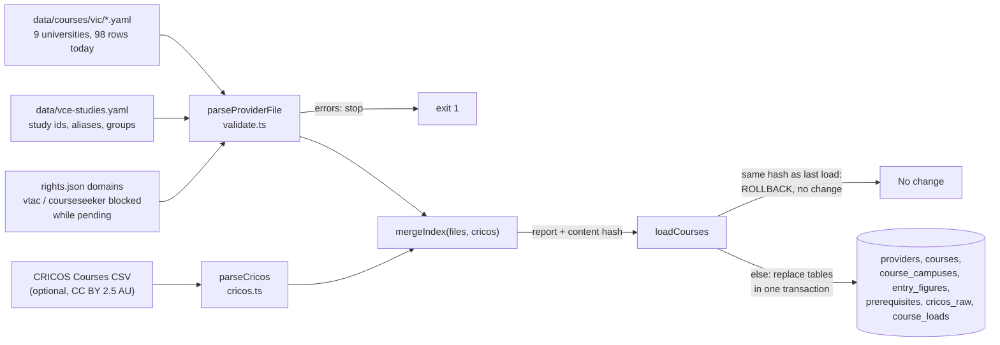
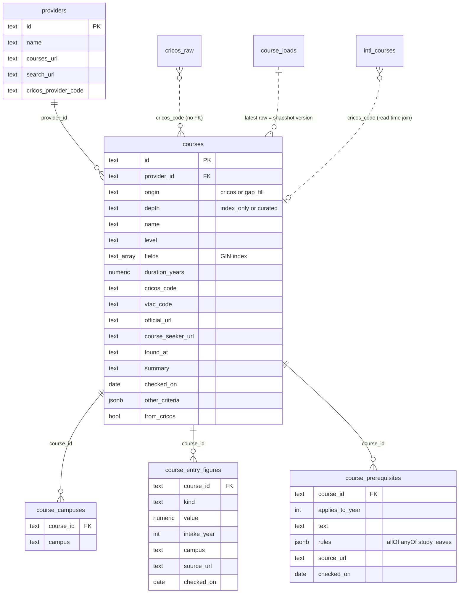
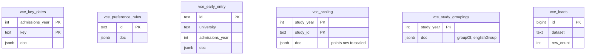
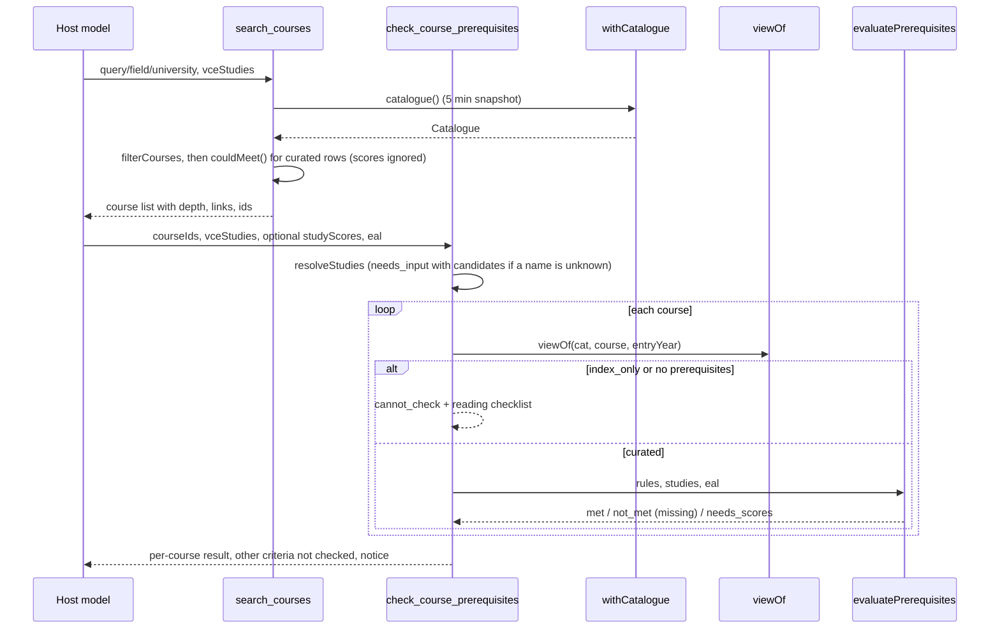

# Victorian university courses and VCE planning (vertical `courses`)

Answers "which Victorian courses fit my VCE studies, what were last year's entry figures, what do
the prerequisites say, when are VTAC dates, which early entry schemes exist" without ever
predicting entry. **Internal route only** until the promotion gates pass
([`../promotion-checklist.md`](../promotion-checklist.md)).

Notes marked **(inferred)** are my reading of the code; **(unverified)** means the code or docs
leave it open. Read at commit `ff220c9`; nothing was run. Related docs:
[`../course-data.md`](../course-data.md) (curation guide), [`../course-tools.md`](../course-tools.md),
[`../vce-admissions-data.md`](../vce-admissions-data.md), [`../data-rights.md`](../data-rights.md). Specs:
`openspec/changes/add-vic-course-data`, `add-vce-admissions-data`, `add-vic-course-tools`,
`add-course-data-permissions`.

## 1. Data: how it is loaded and refreshed

Two loads, both manual CLI commands run from a machine that can reach the database (the VM). There
is no timer and the server never reads `data/` while serving.

| Command | Reads | Writes | Code |
| --- | --- | --- | --- |
| `courses:validate` | `data/courses/vic/*.yaml`, `data/vce-studies.yaml` | nothing; exit 1 on any rule failure (CI runs it) | `cliCoursesValidate` in `src/courses/cli.ts` |
| `courses:load [--cricos FILE.csv]` | the same, plus an optional CRICOS Courses CSV | tables `providers`, `courses`, `course_campuses`, `course_entry_figures`, `course_prerequisites`, `cricos_raw`, `course_loads` | `cliCoursesLoad` -> `mergeIndex` -> `loadCourses` in `src/courses/load.ts` |
| `courses:check-pages` | URLs cited by curated rows | nothing; fetches each at most once a second and prints status | `cliCoursesCheckPages` |
| `vce:validate` | `data/vce/*.yaml`, plus scaling and grouping JSON from `data/vce/` or git-ignored `data/local/` | nothing | `cliVceValidate` -> `readVceFiles` in `src/vce/load.ts` |
| `vce:load` | the same | `vce_key_dates`, `vce_preference_rules`, `vce_early_entry`, `vce_scaling`, `vce_study_groupings`, `vce_loads` | `cliVceLoad` -> `loadVce` |

### 1.1 Course index (`data/courses/vic/<university>.yaml`)

What the validator enforces (`parseProviderFile`, `src/courses/validate.ts`; also in
`docs/course-data.md`):

- A provider block with `id`, `name`, `coursesUrl` and `domains`.
- **Depth is derived, not declared.** A row is `curated` when it has a `summary`, entry figures or
  prerequisites; otherwise `index_only`. A curated row needs a summary (at most 60 words, no banned
  phrase), an `officialUrl` on the provider's domain and `checkedOn`.
- `origin` is `cricos` or `gap_fill`; a `gap_fill` row needs `foundAt`.
- Entry figure `kind` in `FIGURE_KINDS` (`lowest_atar`, `lowest_selection_rank`, `guaranteed_atar`,
  `entry_threshold`, `median_atar`), value 0 to 99.95, intake year in range, `sourceUrl`, `checkedOn`.
- Prerequisite blocks: `appliesToYear`, `text` (our paraphrase), `sourceUrl`, `checkedOn`, and `rules`
  as a tree (`allOf`, `anyOf`, leaves `{study, minScore, ealMinScore}`) whose study ids must exist in
  `data/vce-studies.yaml`.
- Source URLs must be on the provider's domain or `education.gov.au`, `data.gov.au`,
  `vcaa.vic.edu.au`; sources on `vtac.edu.au` or `courseseeker.edu.au` fail while the matching
  rights entry is not cleared. Links (not content) to those sites are allowed in `officialUrl` /
  `courseSeekerUrl`.

`mergeIndex` (pure, no database):

1. Takes each YAML row. If it has a `cricosCode` and a CRICOS file was supplied, the row is matched
   by code: `fromCricos` is set, the official CRICOS name replaces the name of an index-only row,
   duration and campuses are filled when absent, and a warning is added when a curated row's name
   differs. A code missing from the file warns, and drops an index-only `cricos` row.
2. For providers with a `cricosProviderCode`, every undergraduate CRICOS row not already used
   (`isUndergraduate`: bachelor or associate degree, not postgraduate) is **added as an
   `origin: cricos`, `depth: index_only` row** with id `<provider>-cricos-<code>`.
3. Produces a report (counts by origin and depth, rows without an official link, warnings) and a
   16-character SHA-256 content hash. `loadCourses` compares the hash with the last
   `course_loads.report.hash` and does nothing if equal.

State of the data today (counted from the repo): 98 rows across nine universities; only RMIT
Engineering (Honours) carries a summary, entry figures and prerequisites; its `checkedBy` is
`claude-draft`, i.e. **(inferred)** not yet re-read by a person. The 97 other rows are `gap_fill`
stand-ins built from course names and links in the earlier pilot, per `docs/course-data.md`; no real CRICOS
file has been loaded for the domestic index. The domestic CRICOS parser (`src/courses/cricos.ts`)
reads `locations` from a column of the Courses sheet, but `docs/cricos-columns.md` says the real
file keeps locations on a separate "Course Locations" sheet, and `courses:load` takes only
`--cricos`. **(inferred)** so a real domestic load would give CRICOS-origin rows with no campuses
unless that is changed. The title-row skip was added in PR #15 (`parseCricos` finds the header
within the first ten rows).

### 1.2 VCE admissions data (`data/vce/`)

| File | Becomes | Notes |
| --- | --- | --- |
| `key-dates.yaml` | `vce_key_dates` | per admissions year; each date has `issuingBody` (VCAA or VTAC), source link, `checkedOn`, `provisional` flag. Dates are provisional until re-read (task 1.2 of `add-vce-admissions-data`). |
| `preference-rules.yaml` | `vce_preference_rules` | our own-words summary of how preferences and offers work |
| `early-entry.yaml` | `vce_early_entry` | schemes, **no eligibility field**: `readVceFiles` errors if one is present |
| `scaling-YYYY.json` | `vce_scaling` | raw-to-scaled points per study. **Permission pending**: committed only when VTAC's written permission is recorded; dev copies live in git-ignored `data/local/` |
| `study-groupings-YYYY.json` | `vce_study_groupings` | study area groups for the aggregate. Same restriction |

`readTables(dir, ["vce","local"], ...)` looks in both folders. `loadVce` deletes and re-inserts all
five tables in one transaction and writes one `vce_loads` row per dataset. In production the rights
gate keeps `vce-scaling` and `vce-study-groupings` answering `data_unavailable` while their status
is `pending`, even if the tables are loaded.

### 1.3 Serving-side refresh

`CourseStore.catalogue()` and `VceStore.data()` read whole tables into memory and cache the
snapshot for five minutes (`ttlMs`), so a reload is visible within about five minutes without a
restart. Queries run under a 2-second statement timeout (`STATEMENT_TIMEOUT_MS`). If no row exists
in `course_loads` the store throws `NoCourseLoad` and tools answer `data_unavailable` with "has not
been loaded yet".

## 2. How the tables and objects are linked

VCE tables are independent of `courses` and hold one validated JSON document per row:

The soft links that matter:

- **Study ids.** `data/vce-studies.yaml` (parsed by `src/courses/studies.ts`: `loadStudies`,
  `matchStudy`, `expandStudyId`) is the shared vocabulary. Prerequisite rule leaves, the scaling
  tables, the groupings and the student's typed study names all resolve to the same ids.
- **Early entry to course**: `list_early_entry_schemes` takes a `courseId`, looks the course up in
  the catalogue and filters schemes by that course's university name.
- **Domestic to international**: `intl_courses.cricos_code` is matched to `courses.cricos_code` when
  the international store loads (see the international doc).
- In memory these become `Catalogue { providers, courses, loadedAt }` (`src/courses/catalogue.ts`)
  and `VceData` (`src/vce/types.ts`).

## 3. Main functions and the end-to-end processes

### 3.1 Process: "I take English, Chemistry and Biology. Which of these courses rule me out?"

| Function | File | What it does |
| --- | --- | --- |
| `startCourses` | `src/courses/index.ts` | Opens a pool with a 2 s statement timeout, builds `CourseStore` and `VceStore`, registers six datasets (`vic-courses`, `vce-key-dates`, `vtac-preference-rules`, `vic-early-entry`, `vce-scaling`, `vce-study-groupings`; max age 400 days), adds readiness check `vic-courses` (schema >= 3 and courses > 0). No `DATABASE_URL` means the vertical stays off. |
| `withCatalogue`, `withVce` | `src/courses/index.ts` | Wrap every read: missing runtime, `NoCourseLoad` or database error becomes a `data_unavailable` not-found. |
| `filterCourses`, `matchProvider`, `findCourse`, `providerOf` | `src/courses/catalogue.ts` | Normalised word matching on name, fields and summary; university by id, name or distinctive word; field and campus filters. |
| `viewOf` | `src/tools/course-common.ts` | The key branch. An `index_only` row (or a row with no figures, prerequisites or summary) becomes a view with `INDEX_ONLY_MESSAGE`, `READING_CHECKLIST` and `BROWSING_RULES` and **no figures**. A curated row becomes a view with figures labelled by `FIGURE_LABEL[kind](year)` and the prerequisite block for the requested year, falling back to the latest earlier year with a warning. |
| `searchCourses` (`search_courses`) | `src/tools/course-tools.ts` | Filters; with `vceStudies` keeps courses the studies *could* meet (`couldMeet`, scores ignored) and always keeps index-only rows; `figureAtMost` and `orderBy: figure` use `latestSelectionRank`; pages by cursor. |
| `getCourse` (`get_course`) | same | One course view; for index-only, the source is the university page. |
| `compareCourses` (`compare_courses`) | same | Two to five courses side by side, no winner. |
| `checkCoursePrerequisites` (`check_course_prerequisites`) | same | Up to ten courses; per course `met`, `not_met`, `needs_scores` or `cannot_check`. The outcome counter becomes `cannot_check` if any row is. |
| `evaluatePrerequisites`, `couldMeet` | `src/courses/prerequisites.ts` | Recursive `allOf` / `anyOf` / leaf evaluation. A leaf expands study groups, applies the EAL minimum for EAL studies (or English studies when `eal` is true), and returns `needs_scores` when a minimum exists but no score was given. |
| `resolveStudies` | `src/tools/course-common.ts` | Maps typed study names and parallel scores to ids; unknown or ambiguous names return `needs_input` with candidates. |
| `courseFound`, `asOfFor`, `indexSource` | `src/tools/course-common.ts` | Wrap results with `COURSE_NOTICE`; as-of is the oldest `checkedOn` among shown facts, else the load time; source is the index, with CRICOS attribution when `fromCricos`. |
| `getSubjectScaling` (`get_subject_scaling`), `estimateVceAggregate` (`estimate_vce_aggregate`) | `src/tools/planning-tools.ts` | Scaling points per study; aggregate from four to six studies with expected scores. `data_unavailable` when the table or groupings are not held (and in production while the rights entries are pending). |
| `computeAggregate`, `scaledAt` | `src/vce/aggregate.ts` | Pure: highest English-group scaled score plus next three (at most two per study group), plus 10% of up to two increments (at most three per group overall); linear interpolation between published points is flagged `interpolated`. An aggregate is never converted to an ATAR (`AGGREGATE_NOTICE`). |
| `getVceKeyDates` (`get_vce_key_dates`), `listEarlyEntrySchemes` (`list_early_entry_schemes`) | `src/tools/planning-tools.ts` | Dated facts per admissions year with source and `provisional`; schemes described, never judged. |
| `COURSE_INSTRUCTIONS`, `COURSE_NOTICE`, `BANNED_PHRASES` | `src/courses/instructions.ts`, `notice.ts` | Host guidance and wording rules; `bannedIn` is also used by the YAML validator. |

### 3.2 Process: an index-only course (guided browsing)

`get_course` returns links plus a reading checklist (entry figure with kind and intake year,
prerequisites with minimums and EAL, other selection criteria, the page's updated date) and
`BROWSING_RULES` (university page first, then Course Seeker, never VTAC; quote only the checklist
items with link and time; say they were read by the assistant, not from Ask Righto's data; never get
past a bot check). The server never fetches pages and never accepts facts read by the host
(AGENTS.md rule 1). Whether real browsing assistants honour this on the university sites is
**(unverified)**: the cloud test reached 7 of 18 pages and bot checks blocked several (project memory,
`docs/permissions`), and the Claude in Chrome rerun is untested.

### 3.3 Process: refreshing the data

Annual re-check (docs/course-data.md): each March and August run `courses:check-pages`, re-read
curated pages, update figures and prerequisites, run `courses:validate`, open a pull request; after
merge and deploy, run `courses:load` and `vce:load` on the VM.

## 4. Known limits and open items

- Curation depth: one curated course. Launch coverage target is not set.
- The CRICOS index is not loaded; the 97 stand-in rows depend on pilot names and links.
- Dates and early-entry schemes are provisional; the early-entry list covers six universities.
- Scaling and groupings wait on VTAC's written permission; the permission requests are drafted in
  `docs/permissions/` and, as far as the project notes say, not yet sent.
- `cleared_pending_legal_view` on the four own-words datasets blocks public promotion (the
  `release:check` script prints it).
- `courses:gap-report` and the 12-word verbatim-run check are not implemented
  (`docs/course-data.md`, "Not done yet").
- Tests: `test/courses/*` (units, tools, DB), `test/data-rights.test.ts`, `test/rights.test.ts`,
  `test/verticals.test.ts`.
